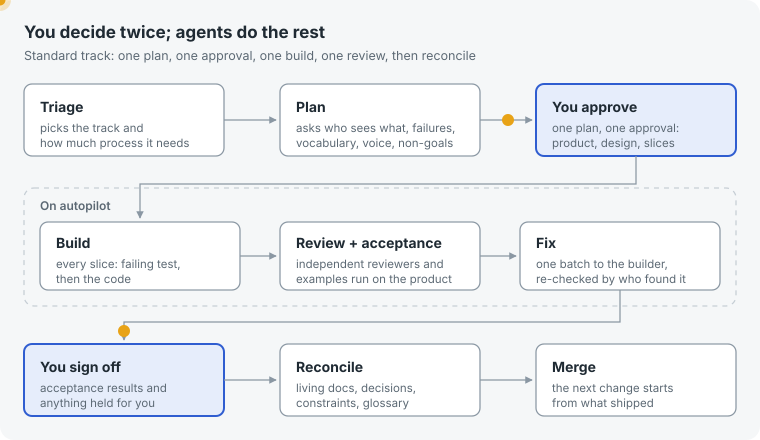
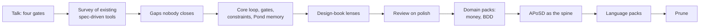
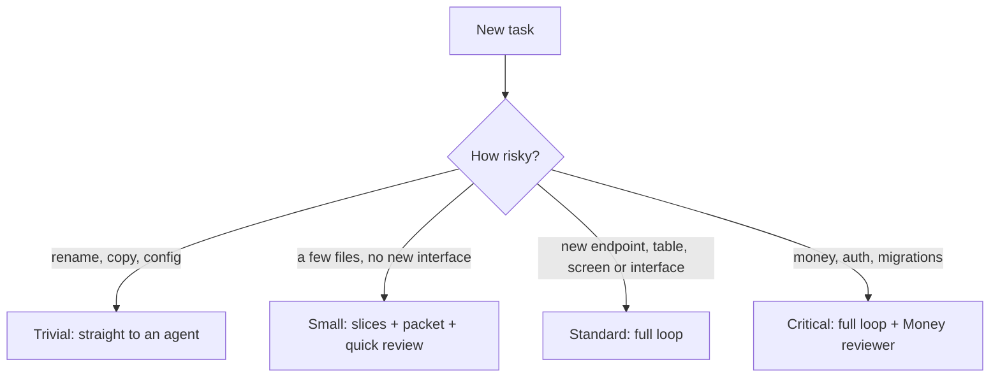
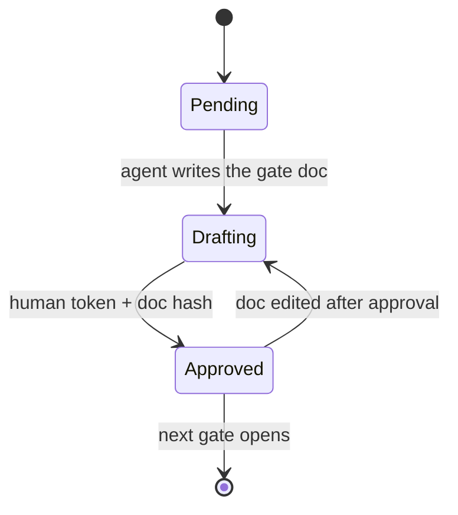
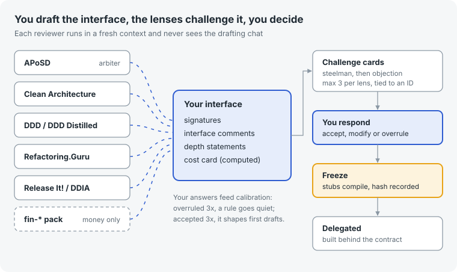

# Software Factory

A reusable set of agent skills, a shared git-backed kit, and [Pond](https://github.com/tenequm/pond) as the memory layer, that together turn feature work in any repository into a gated loop: you design the interface, agents build the implementation, and you still read every diff.



**Status:** roadmap S1 to S8 built; not yet run end to end on a real feature.

## TL;DR

1. Install the skills and the kit once:
   ```bash
   ln -s ~/Work/software-factory/skills/factory-* ~/.claude/skills/
   ln -s ~/Work/software-factory/kit ~/.software-factory
   ```
   Review also needs the [`polish`](https://github.com/tenequm/skills/tree/main/skills/polish) skill.
2. In the repository you want to change, start with `/factory-triage <the task in plain words>`.
3. Follow the hand-offs, one fresh session each: `/factory-product`, `/factory-architecture`, `/factory-interface`, `/factory-slices` (track small: slices only), then `/factory-build` and `/factory-review` per slice, then `/factory-reconcile` before you merge.
4. You approve every gate and sign off every slice. The optional hard-gate hook and the headless runner are in [skills/README.md](skills/README.md).

---

## Why it exists

I work across many repositories, stacks and domains at once. AI coding agents made the typing cheap, but the parts that actually decide whether a codebase survives (product decisions, architecture, interface design, review) stayed expensive, and agents left alone made them worse. The goal of this project is to take at least half of the build time off my plate **without** giving up ownership of the code.

## How it was born

The starting point was Dex Horthy's talk at AI Engineer World's Fair 2026, [Why Software Factories Fail](https://www.youtube.com/watch?v=Ib5GBkD555M). Its argument, in short: coding models are trained to make tests pass, nothing in that training penalizes poor design, and the cost of bad architecture arrives months later. Better harnesses and more tokens can raise the floor, but they cannot replace human design judgment. His answer is to turn review back on and make it cheap by moving decisions earlier: **product, then architecture, then program design, then vertical slices**, with roughly half an hour of alignment saving hours of review.

From there the design grew in steps:



1. **Survey.** I looked at what the most-used spec-driven and agent-workflow projects already do: GitHub Spec Kit, OpenSpec, Superpowers, BMAD, Get Shit Done, the community QRSPI implementations of Dex's newer workflow, and a few smaller ones. Notes are in [docs/LANDSCAPE.md](docs/LANDSCAPE.md).
2. **Gaps.** Every one of them solves part of the problem. None of them treats constraints and NFRs as first-class, almost none has a real program-design step, approval is usually a chat message, specs drift after shipping, and memory stops at the repo boundary.
3. **Core design.** The loop in the picture above, hard gates, a constraints registry, a handoff packet per slice, and Pond as cross-project memory.
4. **Everything after** came from using the design against the tools I already rely on: design-book lenses, my review skill, domain packs for money and BDD, language packs, and a prune step. Each choice is explained below and in [docs/DECISIONS.md](docs/DECISIONS.md).

---

## The core ideas

**You own the interface, agents own the implementation.** Think of a wall socket: you decide its shape, its voltage and what happens on overload; the electrician wires the wall however they like but cannot change the socket. Interface design is the gate you spend the most time on. Everything after it is delegated.

**You still read every diff.** The point of the early gates is that review turns into "yes, this is what we agreed", not a design argument on a finished pull request.

**Decisions live in files, not chat.** Every gate and every slice compacts into documents. A fresh session, or a server, picks up from the files alone.

**Mechanical before model.** If a script can check it (imports, signatures, dead code, red tests), no agent spends a token on it.

**Process scales to risk.** A one-line fix goes straight to an agent. A change that moves money gets the full loop and an extra reviewer.

**Stack-agnostic.** All gate logic is stack-free. Anything specific to a language lives in a small adapter file.

---

## The loop, stage by stage

| Stage | What happens | What it produces |
| --- | --- | --- |
| Triage | Picks the track, detects money and BDD per module, picks the lens profile and language pack | `status.yaml` |
| Product | Problem, success metric, the announcement you would write before building, mockups; requirements in EARS form; rules and examples worked out with Example Mapping | `01-product.md` |
| Research | A sub-agent receives only the questions, never the task, and returns facts with file and line references | `research.md` |
| Architecture | Fit with the existing system, contracts, data, flow; NFRs become measurable budgets; each decision becomes an ADR | `02-architecture.md`, ADRs |
| Interface Design | You draft signatures and interface comments; lenses challenge them; you answer; stubs compile and freeze | `03-interface.md`, stubs |
| Slices | Vertical slices, tracer bullet first; each slice names the requirements it covers and how it is verified | `04-slices.md` |
| Packet | Everything one executor needs and nothing else | `slices/NN/packet.md` |
| Build | Fresh executor; new tests must fail on the base commit before code is written | code + tests |
| Review | Scripts first, then parallel review agents, then your approval | `slices/NN/review.md` |
| Reconcile | Folds what shipped back into living specs, ADRs, constraints and lessons | updated `.factory/system/` |

### Tracks



### Hard gates

Approval is a recorded token tied to a hash of the gate document. If the document changes after approval, that gate and everything after it revert. Before slices are approved, a hook blocks edits to source files. On a server, approval comes from a pull-request review or a tracker state change, never from the agent.



---

## Interface Design: the gate you own



The spine is John Ousterhout's *A Philosophy of Software Design*: deep modules with small interfaces that hide real complexity. You draft each module's signatures, its interface comments (what it promises, never how), and a one-line statement of what it hides. A cost card is computed from the stubs: public methods, exposed errors, exposed configuration, pass-through methods, and how many modules each planned slice touches.

Then fresh-context reviewers challenge the draft, one book or pack each. To keep that fair:

- Every challenge must quote the exact signature, argue **for** your current design first, then state the objection, propose an alternative signature and say what that alternative costs.
- A challenge can only block if it points at a constraint ID or a cost-card number. Anything else is taste and stays a note.
- At most three challenges per lens. Zero is allowed, but the reviewer must name the strongest objection it considered and dropped.
- Reviewers never see the drafting conversation, so they judge the interface the way a future reader would.
- When two lenses disagree, both sides come to you, and your call becomes an ADR.

Your answers are logged. A rule you overrule three times goes quiet for you; a rule you accept three times becomes a principle that shapes first drafts. Money and security rules never go quiet.

---

## Review: scripts first, agents second, you last



Review is built on a `/polish` skill: parallel read-only agents for cleanliness, design and reuse, efficiency, and side-effect gating, findings validated against the actual code, a report, and nothing fixed until you approve by number. On top of it:

- **Phase 1 grows.** The import graph (Clean Architecture's dependency rule), interface conformance against the frozen stubs, a dead-code tool and the language pack's linter rules all run as scripts.
- **Books become rubric, not extra agents.** Refactoring.Guru and Ponytail's simplification ladder ride inside the design and reuse agent; the language pack rides inside design and efficiency.
- **Two agents are conditional.** An APoSD reviewer runs only when a slice adds public surface beyond the frozen interface; a Money reviewer runs only on critical slices in repositories that move money.
- **A frozen signature change is not a fix.** It sends the slice back to Interface Design.

A typical slice costs four review agents. The worst case, a money slice that touches an interface, costs six.

---

## What plugs in, and when

| Pack | Source | Loads when |
| --- | --- | --- |
| Design-book lenses | [ciembor/agent-rules-books](https://github.com/ciembor/agent-rules-books) | Per project profile, at most two per step |
| Money | [nbailo/financial-engineering-skills](https://github.com/nbailo/financial-engineering-skills) | Triage finds money signals and you confirm |
| BDD | [Cucumber's BDD practices](https://cucumber.io/docs/bdd/) | Discovery everywhere; Gherkin only where a module already uses it |
| React / Next.js | [vercel-labs/agent-skills](https://github.com/vercel-labs/agent-skills) | `package.json` with React or Next |
| Rust | [leonardomso/rust-skills](https://github.com/leonardomso/rust-skills) | `Cargo.toml` |
| Go | [cxuu/golang-skills](https://github.com/cxuu/golang-skills) | `go.mod` |
| Python | [trailofbits/skills](https://github.com/trailofbits/skills) `modern-python` + [wshobson/agents](https://github.com/wshobson/agents) `python-development` | `pyproject.toml` and friends |
| Simplification | [DietrichGebert/ponytail](https://github.com/DietrichGebert/ponytail) | Packet, review rubric, and the prune job |
| Memory | [tenequm/pond](https://github.com/tenequm/pond) | Always: every session is recorded; gates, review and reconcile query it |

Every third-party pack is vendored into `~/.software-factory/` and pinned by commit, so an upstream change never lands in the middle of a feature.

### Lens profiles

| Profile | Lens order | Typical repo |
| --- | --- | --- |
| `domain-core` | DDD Distilled, DDD, Clean Architecture, APoSD, Release It! + DDIA | Ledgers, core business logic |
| `crud-service` | PoEAA, Clean Code | Admin panels, simple CRUD |
| `legacy` | Working Effectively with Legacy Code + Refactoring first | Brownfield without tests |

---

## Why these decisions

The full log with trade-offs is in [docs/DECISIONS.md](docs/DECISIONS.md). The short version:

- **Skills plus files, not a platform.** Skills follow the open Agent Skills format, so the same loop runs in Claude Code, Codex, OpenCode or Pi, on a laptop or a server.
- **Decisions in files, recall in Pond.** Gate docs, ADRs and constraints have to be diffable and reviewable in pull requests, so they are markdown in git. Everything else agents did, said and were told lives in Pond: lossless, searchable, and shared across machines, so nothing has to be summarized by hand to be remembered.
- **Hard gates.** Every tool I surveyed treats approval as a convention. A tired evening is exactly when a plan that only looks finished slips into code.
- **A constraints registry.** Requirements without enforcement are wishes. Every ID must end in a test, a lint rule, a monitor, or an explicit "a human checks this".
- **APoSD as the spine.** Interfaces are the decisions that are expensive to change later and cheap to change now. Owning them is the highest-leverage use of human attention.
- **No design-it-twice step.** Challenge cards already bring targeted alternative signatures, at a fraction of the cost.
- **Lenses, not a rulebook.** Classic design books disagree with each other in places; loading all of them at once gives the agent noise. Profiles pick a small, coherent set.
- **Review on `/polish`, not a heavier variant.** A converging multi-round reviewer was tried and dropped: it burned too many tokens for what it added. Its two cheap ideas (findings on disk, and regression tests that must fail when their fix is reverted) were kept.
- **Money rules only where money moves.** A money pack in a CRUD admin panel is pure noise; in a payout worker it is the most valuable reviewer in the room.
- **BDD without forcing it.** Concrete examples are the cheapest way to find out you misunderstood a requirement, so example-first discovery runs everywhere. Gherkin files and runners only appear where a module already has them, because adding a test framework to someone's repo is a decision, not a side effect.
- **Language packs.** Book lenses decide where boundaries go; a language pack decides how to say it well in that language. Linter-catchable rules go to the linter.
- **Prune as its own job.** Agents are biased toward adding code. A scheduled, approved, behavior-preserving prune pass pushes back, without ever touching frozen interfaces or constraint-enforcing code.

---

## Memory: Pond

[Pond](https://github.com/tenequm/pond) stores every agent session losslessly, from Claude Code, Codex, OpenCode and other clients, with semantic search, read-only SQL and an MCP server. Point every laptop and server at one shared store (S3, GCS or Azure) and the factory remembers across repositories, machines and harnesses.

The factory uses it in three places:

- **Gates and research** search Pond for prior decisions, rejected designs and incidents that touch the same modules before drafting.
- **Review** checks findings against what was already accepted or overruled, so the same argument does not come back.
- **Reconcile** queries Pond for recurring findings and accept or overrule counts per lens rule. Lessons and calibration are computed, not hand-maintained. A rule that keeps getting accepted is promoted into `principles.md`.

What is curated stays in files:

```
~/.software-factory/                      global kit: a symlink to this repository's kit/
  principles.md                  engineering taste, with reasons; shapes first drafts
  nfr-catalog/<domain>.md        default NFRs per domain
  profiles/                      domain-core, crud-service, legacy
  lenses/                        vendored packs, pinned by commit
  adapters/<stack>.md            typecheck stubs, run tests at a commit, import graph, dead code, BDD runner

<repo>/.factory/system/          living product, architecture, constraints, glossary, ADRs, lenses.yaml
<repo>/.factory/changes/<slug>/  status.yaml, gate docs, slices/NN/{packet,review}.md
```

Book rules are priors. Your project history, in Pond, wins.

---

## Repository layout

| Path | What is there |
| --- | --- |
| [docs/DESIGN.md](docs/DESIGN.md) | The full design record |
| [docs/DECISIONS.md](docs/DECISIONS.md) | Every decision with context, reasoning and trade-off |
| [docs/LANDSCAPE.md](docs/LANDSCAPE.md) | The tools surveyed and the gaps they leave |
| [kit/](kit/) | Starter content for `~/.software-factory/`: NFR catalogs, lens profiles, language packs, stack adapters, pack pins |
| [skills/](skills/) | Where the factory skills land, starting with S1 |
| [runner/](runner/) | The headless runner: approvals from pull-request reviews, one skill run per pass |
| [hooks/](hooks/) | The hard-gate hook for Claude Code, with its self-check |
| [assets/](assets/) | Diagrams used in this README |

## Roadmap

1. **S1, tracer bullet:** triage, one combined plan doc, a packet, one executor and review, end to end on one real feature.
2. **S2:** separate gates with templates and line budgets; `status.yaml`; money and BDD detection.
3. **S3:** constraints registry, first NFR catalog, lens profiles, language packs with linter mappings.
4. **S4:** Interface Design (cost card, compilable stubs through adapters), research firewall, BDD test plans.
5. **S5:** hard gates (document hashes, hooks).
6. **S6:** build orchestrator with the red check, challenge panel, review integration.
7. **S7:** reconcile, global kit, lessons and calibration from Pond queries, changelog-triggered re-review of pinned packs.
8. **S8:** headless mode: gates through pull requests or a tracker, runner on a server.

The factory is built with its own loop.

### Future releases

Three specialist skills, each with the factory's habits: mechanical evidence before model judgment, opinions anchored to the product's own goals, and every proposed change run as a small factory change you approve.

**S9: `factory-ui-ux`, a designer with taste and a spine.** Today's design skills polish surfaces: they rarely remove AI slop and hold no view on what the product should be. This one does both.

- **Taste brief first.** From the product gate (problem, success metric, who the user is) it writes the product's design principles into `.factory/system/design.md`, positions included: what this product refuses to look like, the one primary action per screen, the words users actually say. Every later judgment cites the brief, not generic best practice.
- **De-slop as a mechanical pass.** A catalog of slop patterns (gradient heroes, emoji bullets, interchangeable card grids, centered everything, filler copy, decorative motion) checked from code and from real screenshots before any taste opinion.
- **Opinions with a cost.** Findings use the challenge card: the current design argued fairly first, then the objection, a concrete alternative and what it costs, anchored to the brief or the success metric. It recommends cutting things, not only restyling them.
- **Seen, not imagined.** Screens rendered in a real browser at each breakpoint, with accessibility, empty and error states, and React Doctor's runtime scan where it applies.
- **Where it plugs in:** mockups in the product gate, UI states in the interface gate, and review of slices that touch UI.

**S10: `factory-ci`, "why is my CI so slow?"** One question, an answer with numbers.

- **Measured, not guessed.** Reads the workflows and recent runs (`gh run list`, per-job and per-step timings), builds the critical path, and finds where the minutes go: missing caches, redundant setup, serial jobs that could fan out, unsharded test suites, full-history checkouts, sleep-based readiness, workflows triggered on paths they don't need.
- **Ranked by saving.** Each proposal comes with the wall-clock and runner minutes it saves, measured where it can be, and how sure that number is.
- **Posture on the way.** Unpinned actions, broad token permissions, secrets reachable from forks: reported beside the speed findings.
- **Where it plugs in:** on demand, like prune; each accepted proposal runs as a small change.

**S11: `factory-security`, an audit that knows which checks matter here.**

- **Scanners first.** Trivy (dependencies, IaC, containers, secrets), Semgrep, Gitleaks, OSV-Scanner and each stack's own audit tool (`npm audit`, `cargo audit`, `govulncheck`, `pip-audit`), pinned and run like the adapters.
- **Architecture before checklists.** It reads `.factory/system/` (product, ADRs, constraints) and the code map, and writes a threat model: assets, trust boundaries, entry points, who the attackers are.
- **A router, not the whole library.** Large security skill catalogs, such as [anthropic-cybersecurity-skills](https://github.com/mukul975/anthropic-cybersecurity-skills) with 800+ skills or [Claude-Code-CyberSecurity-Skill](https://github.com/Masriyan/Claude-Code-CyberSecurity-Skill), are mostly irrelevant to any one repository; which sources to draw from is decided when S11 is designed. The kit keeps a routing index that tags each pinned security skill by stack, component (web API, auth, payments, infrastructure as code, mobile, LLM features) and threat class. The repository's profile and threat model select the few that apply, and the audit says which it loaded and why the rest were skipped.
- **Findings proven.** Every finding is reproduced from its evidence before it is reported; confirmed ones become small changes, and lasting rules become `SYS-C` rows in the constraints registry.
- **Where it plugs in:** on demand for a full audit; on track critical as the threat model the design already calls for; and as a review lens on slices that touch a trust boundary.

## Credits

The four-gate idea comes from Dex Horthy and [HumanLayer](https://www.humanlayer.com/). The design leans on the authors of the projects and books linked above. Nothing from those books is reproduced here; the lens packs link to their own distilled rule sets.

## License

[MIT](LICENSE). Third-party packs linked above keep their own licenses; they are vendored into `~/.software-factory/`, not into this repository.
