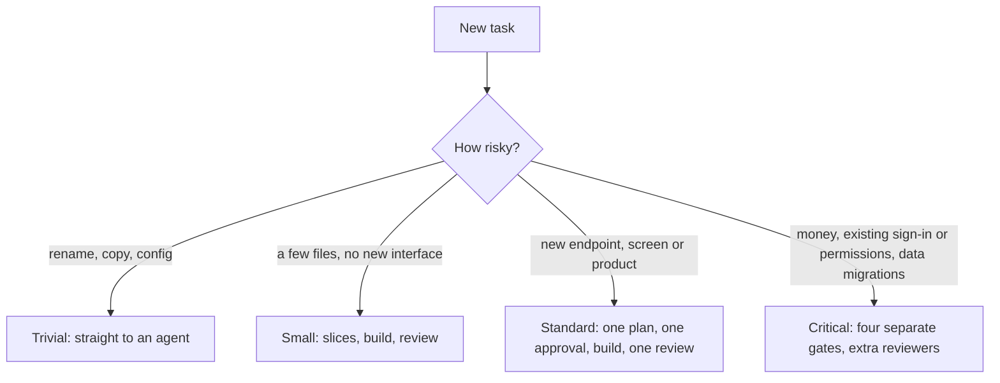
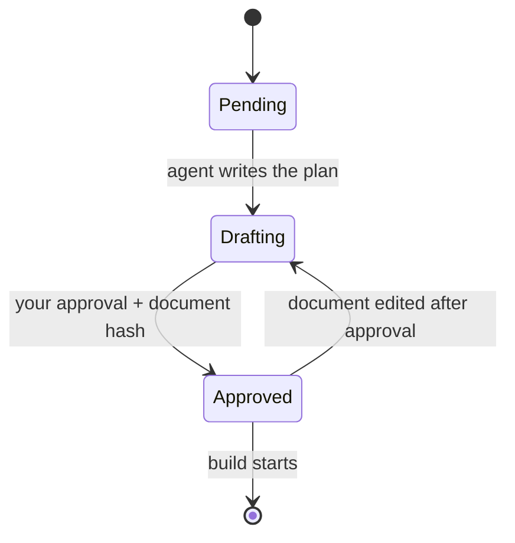

# Software Factory

Agent skills that turn a plain-language request into shipped, reviewed code in any repository. Agents ask the questions a senior engineer would, write the plan down, build it test-first and get it reviewed. You approve the plan and sign off the result.

## How it works


1. **Triage.** You describe the task in plain words. The factory picks how much process it needs.
2. **Plan.** It asks the questions that change the product: who uses it, who may see what, what happens when things fail, what things are called, how the product should sound. Then it writes one plan and asks for one approval.
3. **Build.** An agent builds each slice test-first: a failing test, then the code.
4. **Review.** Independent reviewers and an acceptance check look at the result. Fixes go back to the builder.
5. **Reconcile.** What shipped folds back into the living docs: decisions, constraints and the glossary. You sign off.

## Tracks

Process scales to risk.



On the critical track, the interface gets its own gate: you draft the signatures, review lenses challenge them, you decide, and the stubs freeze before anything is built.


## Hard gates

An approval is tied to a hash of the document it approves. Edit the document afterwards and that approval, and everything after it, reverts. Until the plan is approved, a hook blocks edits to source files.



## Review

Scripts first, agents second, you last. Anything a script can check never costs a model call.


## Quick start

```bash
~/Work/software-factory/bin/factory-install HEAD
ln -sf ~/Work/software-factory/skills/factory-init ~/Work/software-factory/skills/factory-upgrade ~/.claude/skills/
```

Then, in the repository you want to change:

```text
/factory-init
/factory-triage <the task in plain words>
```

Follow the hand-offs. The factory stops only when it needs your answer.

## Learn more

- [skills/README.md](skills/README.md): every skill, the hard-gate hook and the headless runner
- [kit/README.md](kit/README.md): the shared kit, packs and layouts
- [docs/DESIGN.md](docs/DESIGN.md) and [docs/DECISIONS.md](docs/DECISIONS.md): why it works this way
- [CHANGELOG.md](CHANGELOG.md): what changed

## Credits

The four-gate idea comes from Dex Horthy and [HumanLayer](https://www.humanlayer.com/), from the talk [Why Software Factories Fail](https://www.youtube.com/watch?v=Ib5GBkD555M). Memory across projects comes from [Pond](https://github.com/tenequm/pond).

## License

[MIT](LICENSE). Bundled book rubrics keep their upstream [MIT notice](kit/packs/LICENSE.agent-rules-books). Other third-party packs keep their own licenses.
