<p align="center">
  <picture>
    <source media="(prefers-color-scheme: dark)" srcset="assets/hero-dark.svg">
    
  </picture>
</p>

<p align="center">
  <b>Plumb turns a request into agreed contracts, builds against them test-first,<br>and checks the result against what you agreed.</b>
</p>

<p align="center">
  <a href="#start-in-two-minutes">Start</a> ·
  <a href="#how-it-works">How it works</a> ·
  <a href="#the-scoreboard">Scoreboard</a> ·
  <a href="#review-any-branch">Review a branch</a> ·
  <a href="#documentation">Docs</a>
</p>

<p align="center">
  
  
  
  
</p>

<br>

<p align="center">
  
</p>
<p align="center"><sub>An illustrative session, condensed. Every line is a real step.</sub></p>

<br>

<table>
  <tr>
    <td width="33%" valign="top">
      <h3>Ask what matters</h3>
      Questions in your product's own words, each with a short scenario, two outcomes and a recommended pick. Reply <code>1A 2B</code> and move on.
    </td>
    <td width="33%" valign="top">
      <h3>Freeze the answers</h3>
      Rules, examples, architecture, interfaces and slices become documents bound to exact hashes. An editing hook keeps agents inside the approved plan and the current slice's files.
    </td>
    <td width="33%" valign="top">
      <h3>Build it true</h3>
      Every slice starts from a failing test. Scripts check first, an independent reviewer second, and the agreed examples run on the live product before you sign off.
    </td>
  </tr>
</table>

> [!NOTE]
> **Experimental.** The workflow is implemented. The simplified Opus-led controller has not finished its end-to-end pilot, and [the scoreboard below](#the-scoreboard) shows where the measured version lost. Plumb was named Software Factory until October 2026.

## Start in two minutes

You need **Claude Code**, **Git** and **Python 3.10+**. Pull request and headless workflows also use the GitHub CLI.

```sh
git clone https://github.com/dogebonker/plumb.git
cd plumb
./bin/plumb-install HEAD

mkdir -p "$HOME/.claude/skills"
ln -s "$PWD/skills/plumb-init" "$HOME/.claude/skills/plumb-init"
ln -s "$PWD/skills/plumb-upgrade" "$HOME/.claude/skills/plumb-upgrade"
```

Then, in the repository you want to change:

```text
/plumb-init
/plumb-triage Add a CSV export for the current filtered table
```

Init pins the framework, links its skills into the project and offers the editing hook. Turn the hook on: it is what holds agents to the approved plan. Coming from Software Factory? `/plumb-init` migrates `.software-factory/` in place. [Installation details](skills/README.md#install)

## How it works

<p align="center">
  
</p>

On the standard track you decide twice: once on the plan, once on the result. Between those, agents build, review and repair on their own. Changed promises, security decisions and missing authority come back to you.

| Stage | What it leaves behind |
| --- | --- |
| **Plan** | Product rules with examples, architecture decisions, interfaces and scoped slices |
| **Build** | Tests, implementation and recorded verification for each slice |
| **Review** | Script results, independently validated findings and acceptance evidence |
| **Reconcile** | Shipped decisions, constraints and vocabulary folded into living docs |

Every question opens with a short recap of what we're making and what's decided, so you can answer after a break without scrolling back. Then a concrete scenario: where a person is, what they do, what happens next. [Try three example questions](docs/examples/pre-build-questions.html).

<details>
<summary><b>How much process does a task get?</b></summary>
<br>

| Track | Typical work | Process |
| --- | --- | --- |
| Trivial | A rename, copy change or one-line config edit | Direct execution |
| Small | A few files, no new interface | Slices, build and review |
| Standard | A feature, endpoint, screen or new interface | One combined plan, one approval, build and review |
| Critical | Money, existing access rules or data migrations | Separate gates, explicit budgets and risk reviews |

Risk sets the verification. Design-book lenses are opt-in and sized to the task. Correctness, architecture, security and money checks always stay.

</details>

<details>
<summary><b>Architecture you can check</b></summary>
<br>

A constraint names how it is enforced: a test, a lint rule, an architecture rule, a monitor or a human check. Accepted ADRs carry the same mapping, so a review can cite **ADR 0007** the way it cites a requirement or a frozen signature.

Layout checkers enforce import boundaries. [Archgraph](https://github.com/dogebonker/archgraph) adds cross-stack rules, blast radius and reading order through the [shared adapter](skills/plumb-shared/archgraph.md#shared-adapter), and fails new forbidden edges, cycles and unplanned edges when the approved layout selects it. Missing tools and incomplete graph coverage are reported, never assumed away.

Approved documents are bound to exact hashes. Compatible approvals survive a revision; a changed contract needs its actual decision. [Authority and limits](skills/README.md#hard-gates)

</details>

<details>
<summary><b>Review checks the code and its intent</b></summary>
<br>

Scanners and project checks run first. Reviewers then inspect the behavior behind the contracts, trace side-effect ordering and validate every finding against the code. Acceptance tries the agreed examples on the running product.

A bounded exercise caught a float conversion against an integer-money ADR and stayed silent on the conforming version. That is a small behavioral check, not proof of general review quality. [Cost and limits](docs/research/intent-review-2026-10-19.md)

</details>

## The scoreboard

<p align="center">
  <picture>
    <source media="(prefers-color-scheme: dark)" srcset="assets/scoreboard-dark.svg">
    
  </picture>
</p>

The first full benchmark ran the earlier, sequential workflow against a bare agent and an agent with a good CLAUDE.md, on 20 real merged pull requests with blind review. Plumb lost overall, 9 to 14. [Where its time went](docs/research/benchmark-time-2026-10-25.md) explains why: the critical track ran its gates one by one and hit the 30-minute guard on 8 of 9 tasks. On the other 11, Plumb accepted one more than either control, at six to seven times their median time.

The next version plans the critical track in one pass and asks fewer questions. A rerun on 20 new pull requests will score it, published whatever it shows. [Full protocol and limitations](docs/research/real-pr-benchmark-2026-10-19.md)

## Review any branch

The review layer works without starting a Plumb change:

```text
/plumb-code-review origin/main review
```

Pass a PR URL to review a pull request, or name paths to narrow the scope. In Codex, call `$plumb-code-review` with the same request. One [review skill](skills/plumb-code-review/SKILL.md), one deduplicated report:

- **Polish:** cleanliness, design and reuse, efficiency, side-effect gating
- **Defect hunting:** installed scanners and a bug checklist, each finding with a failure scenario, severity and effort
- **Conformance:** docs, accepted ADRs, standing constraints, frozen contracts and approval integrity

## What works today

| Capability | Where it stands |
| --- | --- |
| Skills, versioned plans, editing hook, test-first slices and independent review | Implemented; project setup targets Claude Code |
| Standalone code review | Implemented for local work and PRs |
| Headless runner | Implemented for a dedicated clone, with real GitHub approver checks |
| Signed GitHub and Linear wake-ups | Local receiver and durable queue implemented; live subscriptions need setup |
| Opus 5.5 lead with bounded subagents, mechanical gates and independent review | Experimental [v2 controller](docs/PLUMB_V2.md); native execution not yet validated |
| Durable v2 checkpoint recovery | Implemented and crash-tested; live provider restart unvalidated |
| Automatic queue recovery and Linear ticket admission | Pending integration |

The skills use the open Agent Skills format. Automatic project linking targets Claude Code; other clients need manual setup.

## Documentation

| Start here | For |
| --- | --- |
| [Skills](skills/README.md) | Commands, installation, hooks and headless operation |
| [Kit](kit/README.md) | Layouts, adapters, principles and pinned packs |
| [Design](docs/DESIGN.md) · [Decisions](docs/DECISIONS.md) | The specification and the reasoning behind it |
| [Plumb v2](docs/PLUMB_V2.md) · [Events and context](docs/PLUMB_EVENTS.md) | Experimental execution and the next integrations |
| [Benchmark](docs/research/real-pr-benchmark-2026-10-19.md) · [Changelog](CHANGELOG.md) | Measurements and changes |

## Built on

The four-gate approach draws from Dex Horthy and [HumanLayer](https://www.humanlayer.com/), including [Why Software Factories Fail](https://www.youtube.com/watch?v=Ib5GBkD555M). [Pond](https://github.com/tenequm/pond) supplies cross-session recall and [archgraph](https://github.com/dogebonker/archgraph) supplies architecture evidence. Pinned third-party packs keep their own attribution.

<sub>[MIT](LICENSE). Bundled book rubrics keep their upstream [MIT notice](kit/packs/LICENSE.agent-rules-books). The README art is generated by [`assets/readme_art.py`](assets/readme_art.py).</sub>
