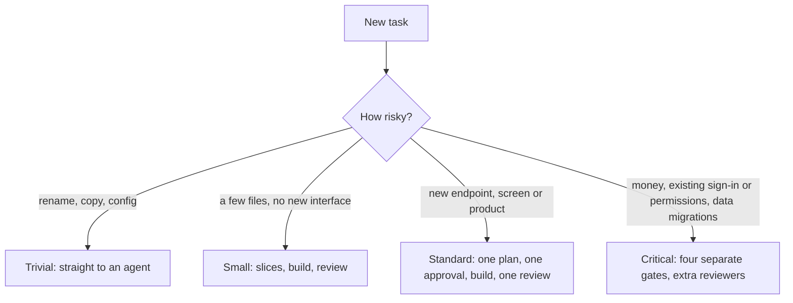
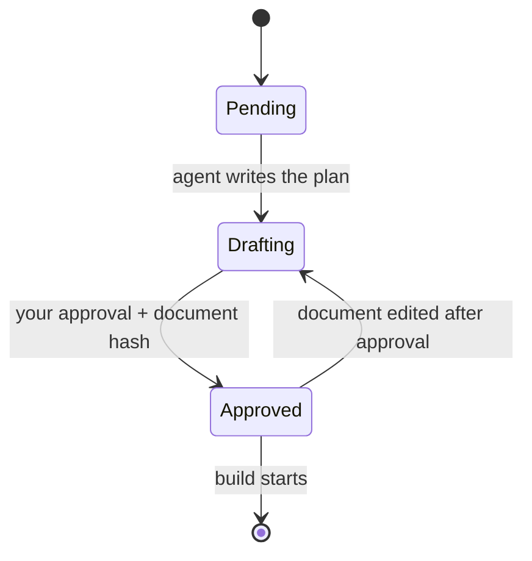

# Software Factory

Agent skills that turn a plain-language request into shipped, reviewed code in any repository. Agents ask the questions a senior engineer would, write the plan down, build it test-first and get it reviewed. You approve the plan and sign off the result.

## How it works


1. **Triage.** You describe the task in plain words. The factory picks how much process it needs.
2. **Plan.** It asks the questions that change the product: who uses it, who may see what, what happens when things fail, what things are called, how the product should sound. Then it writes one plan and asks for one approval.
3. **Build.** An agent builds each slice test-first: a failing test, then the code.
4. **Review.** Independent reviewers and an acceptance check look at the result. Fixes go back to the builder.
5. **Reconcile.** What shipped folds back into the living docs: decisions, constraints and the glossary. You sign off.

## Tracks

Process scales to risk.



On the critical track, the interface gets its own gate: you draft the signatures, review lenses challenge them, you decide, and the stubs freeze before anything is built.


## Hard gates

An approval is tied to a hash of the document it approves. Edit the document afterwards and that approval, and everything after it, reverts. Until the plan is approved, a hook blocks edits to source files.



## Review

Scripts first, agents second, you last. Anything a script can check never costs a model call.


## Why these choices

The full log, with costs and trade-offs, is [docs/DECISIONS.md](docs/DECISIONS.md).

**Process**

| Choice | Why | Instead of |
| --- | --- | --- |
| One plan, one approval (standard track) | The questions find the rules; six separate gates mostly added waiting | Four gates for everything (kept for critical) |
| A fixed discovery checklist | Bugs ship in the rules nobody asked about: who sees what, edits, failures, vocabulary, voice | Free-form brainstorming |
| Tracks by risk | A typo fix and a payout change shouldn't cost the same | One process for every task |
| Approval tied to a document hash | A chat "looks good" lets an unfinished plan slip into code | Approval by convention |
| Slices, tracer bullet first | A thin end-to-end slice surfaces integration problems on day one | Building layer by layer |
| Test fails before the code | A test that never failed proves nothing | Tests written after the code |
| Constraints registry | Every requirement ends in a test, a lint rule, a monitor or a named human check | Requirements as prose |

**Files and memory**

| Choice | Why | Instead of |
| --- | --- | --- |
| Skills plus files | The same loop runs in Claude Code, Codex or OpenCode, on a laptop or a server | A hosted platform |
| Decisions in git | Plans, ADRs and constraints get diffed and reviewed in pull requests like code | Decisions in chat |
| [Pond](https://github.com/tenequm/pond) for recall | Every session is searchable across repositories, so nothing relies on someone writing a lesson down | Hand-written lesson files |
| Packs pinned by hash | Upstream packs move weekly; an update never lands mid-feature | Tracking latest |

**Review and quality**

| Choice | Why | Instead of |
| --- | --- | --- |
| Scripts before agents | Import direction, signatures and dead code are facts, not judgment calls | More review agents |
| One review pass, one fix batch | A converging multi-round reviewer burned tokens for little gain | Reviewing until clean |
| Built on `/polish` | It already validates every finding against the code and treats diffs as untrusted | A reviewer from scratch |
| [Cloudflare security-audit](https://github.com/cloudflare/security-audit-skill) + five scanners | Its evidence bar matches ours; the large catalogs were mostly offensive or failed a full read | Big security skill catalogs |
| DESIGN.md + mechanical de-slop | Models judge design near chance, so they answer closed questions against the product's own file | Generic design skills |
| Voice from the design file | Brand voice belongs to the product; a neutral default erases it | A fixed neutral tone |
| Own CI measurement | Savings must beat the 9–31% run-to-run noise measured on the same repository | ci-speedup's success-only sample |
| Measured retro | Lessons need outside evidence in two changes; memory that keeps everything gets worse | Free-form lesson files |

**Design knowledge**

| Choice | Why | Instead of |
| --- | --- | --- |
| APoSD as the spine | Interfaces are cheap to change now and expensive later | Reviewing implementation only |
| [Book lenses](https://github.com/ciembor/agent-rules-books) by profile, two per step | Books disagree; loading all of them is noise | One big rulebook |
| BDD examples everywhere, Gherkin only where it exists | A concrete example is the cheapest way to catch a misread requirement; adding a test framework is the repo owner's call | Gherkin everywhere |
| [Money pack](https://github.com/nbailo/financial-engineering-skills) only where money moves | Noise in a CRUD panel, the most valuable reviewer in a payout worker | Always on |
| Language packs per module ([React](https://github.com/vercel-labs/agent-skills), [Rust](https://github.com/leonardomso/rust-skills), [Go](https://github.com/cxuu/golang-skills), [Python](https://github.com/trailofbits/skills)) | Books decide boundaries, packs decide idiom; lint-able rules go to the linter | One generic style guide |
| FDA for new frontends | Colocated domains with explicit public entries; existing conventions still win | FSD or feature folders by default |
| [Ponytail](https://github.com/DietrichGebert/ponytail) prune job | Agents add code; a scheduled, behavior-preserving prune pushes back | Ad-hoc cleanup |

## Quick start

```bash
~/Work/software-factory/bin/factory-install HEAD
ln -sf ~/Work/software-factory/skills/factory-init ~/Work/software-factory/skills/factory-upgrade ~/.claude/skills/
```

Then, in the repository you want to change:

```text
/factory-init
/factory-triage <the task in plain words>
```

Follow the hand-offs. The factory stops only when it needs your answer.

## Learn more

- [skills/README.md](skills/README.md): every skill, the hard-gate hook and the headless runner
- [kit/README.md](kit/README.md): the shared kit, packs and layouts
- [docs/DESIGN.md](docs/DESIGN.md) and [docs/DECISIONS.md](docs/DECISIONS.md): why it works this way
- [CHANGELOG.md](CHANGELOG.md): what changed

## Credits

The four-gate idea comes from Dex Horthy and [HumanLayer](https://www.humanlayer.com/), from the talk [Why Software Factories Fail](https://www.youtube.com/watch?v=Ib5GBkD555M). Memory across projects comes from [Pond](https://github.com/tenequm/pond).

## License

[MIT](LICENSE). Bundled book rubrics keep their upstream [MIT notice](kit/packs/LICENSE.agent-rules-books). Other third-party packs keep their own licenses.
