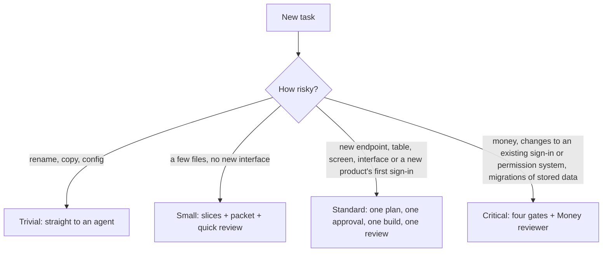
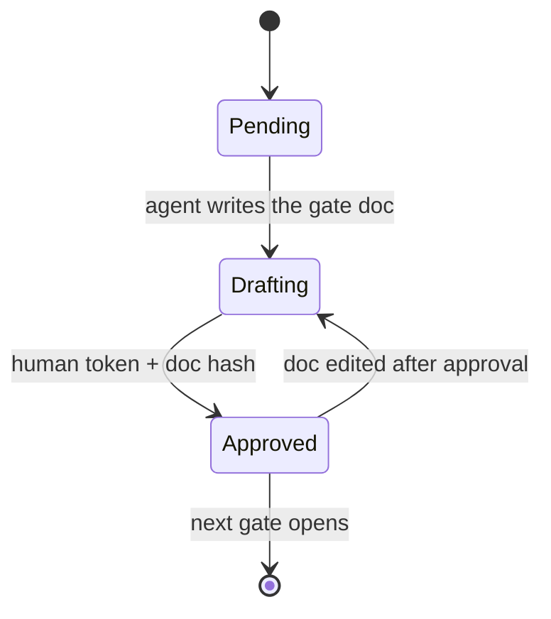

# Software Factory

A reusable set of agent skills, a shared git-backed kit, and [Pond](https://github.com/tenequm/pond) as the memory layer, that together turn feature work in any repository into a gated loop: you design the interface, agents build the implementation, and you still read every diff, a milestone at a time.


**Status:** roadmap S1 to S12 built and used on real changes; S13 evals in progress.

## TL;DR

1. Once per machine, install a factory commit into the framework cache and link the two setup skills for your user:
   ```bash
   ~/Work/software-factory/bin/factory-install HEAD
   ln -sf ~/Work/software-factory/skills/factory-init ~/Work/software-factory/skills/factory-upgrade ~/.claude/skills/
   ```
   To set a project up by hand instead, see [kit/README.md](kit/README.md) and [skills/README.md](skills/README.md).
2. In the repository you want to change, run `/factory-init`: it locks the framework commit, fetches the packs it pins, migrates an old `.factory/`, links the skills and offers the hard-gate hook. Then start with `/factory-triage <the task in plain words>`.
3. Track standard runs `/factory-plan` next, in the same session, then `/factory-build` through `/factory-reconcile`. Other tracks follow the hand-offs, one fresh session each: `/factory-product`, `/factory-architecture`, `/factory-interface`, `/factory-slices` (track small: slices only), then `/factory-build` once: it builds and reviews milestone after milestone and ends in `/factory-reconcile`. Approved local development continues automatically; real scope decisions and final acceptance still need your answer.
4. You approve the discovery gates and execution scope, then sign off acceptance and reconciliation together. Manual milestone and headless PR sign-offs remain available. The optional hard-gate hook and the headless runner are in [skills/README.md](skills/README.md).

---

## Why it exists

I work across many repositories, stacks and domains at once. AI coding agents made the typing cheap, but the parts that actually decide whether a codebase survives (product decisions, architecture, interface design, review) stayed expensive, and agents left alone made them worse. The goal of this project is to take at least half of the build time off my plate **without** giving up ownership of the code.

## How it was born

The starting point was Dex Horthy's talk at AI Engineer World's Fair 2026, [Why Software Factories Fail](https://www.youtube.com/watch?v=Ib5GBkD555M). Its argument, in short: coding models are trained to make tests pass, nothing in that training penalizes poor design, and the cost of bad architecture arrives months later. Better harnesses and more tokens can raise the floor, but they cannot replace human design judgment. His answer is to turn review back on and make it cheap by moving decisions earlier: **product, then architecture, then program design, then vertical slices**, with roughly half an hour of alignment saving hours of review.

From there the design grew in steps:


1. **Survey.** I looked at what the most-used spec-driven and agent-workflow projects already do: GitHub Spec Kit, OpenSpec, Superpowers, BMAD, Get Shit Done, the community QRSPI implementations of Dex's newer workflow, and a few smaller ones. Notes are in [docs/LANDSCAPE.md](docs/LANDSCAPE.md).
2. **Gaps.** Every one of them solves part of the problem. None of them treats constraints and NFRs as first-class, almost none has a real program-design step, approval is usually a chat message, specs drift after shipping, and memory stops at the repo boundary.
3. **Core design.** The loop in the picture above, hard gates, a constraints registry, a handoff packet per slice, and Pond as cross-project memory.
4. **Everything after** came from using the design against the tools I already rely on: design-book lenses, my review skill, domain packs for money and BDD, language packs, and a prune step. Each choice is explained below and in [docs/DECISIONS.md](docs/DECISIONS.md).

---

## The core ideas

**You own the interface, agents own the implementation.** Think of a wall socket: you decide its shape, its voltage and what happens on overload; the electrician wires the wall however they like but cannot change the socket. Interface design is the gate you spend the most time on. Everything after it is delegated.

**Milestones keep the work reviewable.** Each ends where you can try something and retains its diff, independent review and checks. Approved interactive development proceeds to one final acceptance and reconciliation decision; you can request manual milestone pauses.

**Development is an independent loop inside the agreed constraints.** Product and architecture questions stay up front. After approved scope, the executor builds and repairs, independent reviewers inspect the result, and independent acceptance checks the agreed FR/NFR outcomes. Real contract/scope changes return for a decision. Final human reconciliation and publication remain separate.

**Decisions live in files, not chat.** Every gate and every slice compacts into documents. A fresh session, or a server, picks up from the files alone.

**Mechanical before model.** If a script can check it (imports, signatures, dead code, red tests), no agent spends a token on it.

**Process scales to risk.** A one-line fix goes straight to an agent. A change that moves money gets the full loop and an extra reviewer.

**Stack-agnostic.** All gate logic is stack-free. Anything specific to a language lives in a small adapter file.

---

## The loop, stage by stage

| Stage | What happens | What it produces |
| --- | --- | --- |
| Triage | Picks the track, detects money and BDD per module, picks the lens profile and language pack | `status.yaml` |
| Plan (track standard) | One pass instead of the four gates below: at most two batched rounds of discovery questions (roles, who sees what, data lifecycle, failure, vocabulary, brand voice, visual direction, non-goals), then every planning document and one mockup, approved once | `01`–`04` documents, design file, glossary |
| Product | Problem, success metric, the announcement you would write before building, mockups; requirements in EARS form; rules and examples worked out with Example Mapping | `01-product.md` |
| Research | A sub-agent receives only the questions, never the task, and returns facts with file and line references | `research.md` |
| Architecture | Fit with the existing system, the folder layout of every module it creates or extends, proposed from a catalog of reference layouts, contracts, data, flow; NFRs become measurable budgets; each decision becomes an ADR | `02-architecture.md`, ADRs |
| Interface Design | You draft signatures and interface comments, frontend pages and shared components included; lenses challenge them; you answer; stubs compile and freeze | `03-interface.md`, stubs |
| Slices | Vertical slices, tracer bullet first; each slice names the requirements it covers and how it is verified | `04-slices.md` |
| Packet | Everything one executor needs and nothing else | `slices/NN/packet.md` |
| Build | Track standard: one executor builds every slice in order, red then green per slice, while the conductor waits once. Other tracks: fresh executor per slice; new tests must fail on the base commit before code is written; mechanical checks per slice; a milestone's slices run back to back | code + tests, `slices/NN/checks.md` |
| Review | Track standard: once at the end, with independent acceptance alongside. Other tracks: once per milestone. Scripts, one independent general reviewer plus risk specialists, and bounded repairs under the approved scope | `slices/NN/review.md` |
| Reconcile | A fresh agent tries every example on the running product without reading the code; then what shipped folds back into living specs, ADRs, constraints and lessons | `acceptance.md`, updated `.software-factory/system/` |

### Tracks



### Hard gates

Approval is a recorded token tied to a hash of the gate document. If the document changes after approval, that gate and everything after it revert. Before slices are approved, a hook blocks edits to source files. On a server, approval comes from a pull-request review or a tracker state change, never from the agent.



---

## Interface Design: the gate you own


The spine is John Ousterhout's *A Philosophy of Software Design*: deep modules with small interfaces that hide real complexity. You draft each module's signatures, its interface comments (what it promises, never how), and a one-line statement of what it hides. A cost card is computed from the stubs: public methods, exposed errors, exposed configuration, pass-through methods, and how many modules each planned slice touches.

Then fresh-context reviewers challenge the draft, one book or pack each. To keep that fair:

- Every challenge must quote the exact signature, argue **for** your current design first, then state the objection, propose an alternative signature and say what that alternative costs.
- A challenge can only block if it points at a constraint ID or a cost-card number. Anything else is taste and stays a note.
- At most three challenges per lens. Zero is allowed, but the reviewer must name the strongest objection it considered and dropped.
- At most three rounds: a changed signature goes back to the panel once, then to the APoSD reviewer alone; after that, more rounds only if you ask.
- Reviewers never see the drafting conversation, so they judge the interface the way a future reader would.
- When two lenses disagree, both sides come to you, and your call becomes an ADR.

Your answers are logged. A rule you overrule three times goes quiet for you; a rule you accept three times becomes a principle that shapes first drafts. Money and security rules never go quiet.

---

## Review: scripts first, agents second, you last


Review runs one fresh independent read-only reviewer carrying cleanliness, design/reuse, hot-path efficiency and correctness (side-effect gating plus per-language defects). Every finding is validated against the code and every reviewable file is accounted for. Interactive runs apply bounded fixes under the genuinely approved execution scope, record milestone completion separately from human sign-off, and continue to final acceptance and one consolidated decision. Headless runs retain their PR approval and sign-off protocol. On top of it:

- **Phase 1 grows.** The import graph (Clean Architecture's dependency rule), interface conformance against the frozen stubs, a dead-code tool and the language pack's linter rules all run as scripts.
- **Books become rubric, not extra agents.** Applicable compact rules and the simplification ladder ride inside the general reviewer; unavailable packs are reported, never credited as evidence.
- **Specialists follow risk.** UI/accessibility, security and money reviewers run when the actual diff changes those risks; uncertain risk triggers review. APoSD reviews new public surface beyond the frozen interface.
- **A frozen signature change is not a fix.** It sends the slice back to Interface Design.

A typical milestone uses one general reviewer. Specialists add coverage for concrete risks. The existing executor implements validated repairs; the conductor coordinates and verifies. Local retries retain work and reuse valid checks, and regressions prove RED in an isolated clone. New interactive plans explicitly authorize corrective slices for unchanged promises inside the original exact file scope. Independent acceptance can then send a defect through build → review → repair → acceptance without reopening approvals or completed parents. Technical completion requires every applicable quality gate to pass; missing proof stays blocked.

---

## What plugs in, and when

| Pack | Source | Loads when |
| --- | --- | --- |
| Design-book lenses | [ciembor/agent-rules-books](https://github.com/ciembor/agent-rules-books) | Per project profile, at most two per step |
| Money | [nbailo/financial-engineering-skills](https://github.com/nbailo/financial-engineering-skills) | Triage finds money signals and you confirm |
| BDD | [Cucumber's BDD practices](https://cucumber.io/docs/bdd/) | Discovery everywhere; Gherkin only where a module already uses it |
| React / Next.js | [vercel-labs/agent-skills](https://github.com/vercel-labs/agent-skills) | `package.json` with React or Next |
| Rust | [leonardomso/rust-skills](https://github.com/leonardomso/rust-skills) | `Cargo.toml` |
| Go | [cxuu/golang-skills](https://github.com/cxuu/golang-skills) | `go.mod` |
| Python | [trailofbits/skills](https://github.com/trailofbits/skills) `modern-python` + [wshobson/agents](https://github.com/wshobson/agents) `python-development` | `pyproject.toml` and friends |
| Simplification | [DietrichGebert/ponytail](https://github.com/DietrichGebert/ponytail) | Packet, review rubric, and the prune job |
| Reference layouts | `kit/layouts/`, from [docs/research/layouts-selection.md](docs/research/layouts-selection.md): eleven patterns with references and checkers | Existing conventions win; FDA is the strong default for new frontend roots, with explicit small-site/team exceptions |
| Security | [cloudflare/security-audit-skill](https://github.com/cloudflare/security-audit-skill), plus routed packs from OpenAI, Trail of Bits, Sentry and 15 mukul975 skills | `factory-security`; the selection is in [docs/research/security-selection.md](docs/research/security-selection.md) |
| Memory | [tenequm/pond](https://github.com/tenequm/pond) | Always: every session is recorded; gates, review, reconcile and retro query it |

Every third-party pack is pinned by hash, in the framework's `kit/packs.lock.yaml` and in each project's `.software-factory/factory.lock`, so an upstream change never lands in the middle of a feature. The ten configured book rubrics are bundled in `kit/packs/`, including their full, mini and nano files. They ship with framework installs and isolated benchmark snapshots, and matching bundles can fill the shared cache offline. Missing or corrupt required books stop benchmark preparation before a model runs. Profiles still select the relevant books; availability does not load them all into context.

### Lens profiles

| Profile | Lens order | Typical repo |
| --- | --- | --- |
| `domain-core` | DDD Distilled, DDD, Clean Architecture, APoSD, Release It! + DDIA | Ledgers, core business logic |
| `crud-service` | PoEAA, Clean Code | Admin panels, simple CRUD |
| `legacy` | Working Effectively with Legacy Code + Refactoring first | Brownfield without tests |

---

## Why these decisions

The full log with trade-offs is in [docs/DECISIONS.md](docs/DECISIONS.md). The short version:

- **Skills plus files, not a platform.** Skills follow the open Agent Skills format, so the same loop runs in Claude Code, Codex, OpenCode or Pi, on a laptop or a server.
- **Decisions in files, recall in Pond.** Gate docs, ADRs and constraints have to be diffable and reviewable in pull requests, so they are markdown in git. Everything else agents did, said and were told lives in Pond: lossless, searchable, and shared across machines, so nothing has to be summarized by hand to be remembered.
- **Hard gates.** Every tool I surveyed treats approval as a convention. A tired evening is exactly when a plan that only looks finished slips into code.
- **A constraints registry.** Requirements without enforcement are wishes. Every ID must end in a test, a lint rule, a monitor, or an explicit "a human checks this".
- **APoSD as the spine.** Interfaces are the decisions that are expensive to change later and cheap to change now. Owning them is the highest-leverage use of human attention.
- **No design-it-twice step.** Challenge cards already bring targeted alternative signatures, at a fraction of the cost.
- **Lenses, not a rulebook.** Classic design books disagree with each other in places; loading all of them at once gives the agent noise. Profiles pick a small, coherent set.
- **One review pass, not a converging reviewer.** A converging multi-round reviewer was tried and dropped: it burned too many tokens for what it added. Its two cheap ideas (findings on disk, and regression tests that must fail when their fix is reverted) were kept.
- **Money rules only where money moves.** A money pack in a CRUD admin panel is pure noise; in a payout worker it is the most valuable reviewer in the room.
- **BDD without forcing it.** Concrete examples are the cheapest way to find out you misunderstood a requirement, so example-first discovery runs everywhere. Gherkin files and runners only appear where a module already has them, because adding a test framework to someone's repo is a decision, not a side effect.
- **Language packs.** Book lenses decide where boundaries go; a language pack decides how to say it well in that language. Linter-catchable rules go to the linter.
- **Prune as its own job.** Agents are biased toward adding code. A scheduled, approved, behavior-preserving prune pass pushes back, without ever touching frozen interfaces or constraint-enforcing code.

---

## Memory: Pond

[Pond](https://github.com/tenequm/pond) stores every agent session losslessly, from Claude Code, Codex, OpenCode and other clients, with semantic search, read-only SQL and an MCP server. Point every laptop and server at one shared store (S3, GCS or Azure) and the factory remembers across repositories, machines and harnesses.

The factory uses it in three places:

- **Gates and research** search Pond for prior decisions, rejected designs and incidents that touch the same modules before drafting.
- **Review** checks findings against what was already accepted or overruled, so the same argument does not come back.
- **Reconcile** counts accept and overrule answers per lens rule in the repository's own changes, and runs retro on the change's sessions. Lessons and calibration are computed, not hand-maintained. A rule that keeps getting accepted is promoted into the project's `principles.md`, and Pond finds the other projects, so a rule promoted or quieted in two of them is proposed for the user layer.

What is curated stays in files:

```
~/.software-factory/framework/<commit>/   kit/ and skills/ of one factory commit, never edited by projects
  kit/principles.md              framework default principles and quiet rules
  kit/nfr-catalog/<domain>.md    default NFRs per domain
  kit/profiles/                  domain-core, crud-service, legacy
  kit/adapters/<stack>.md        typecheck stubs, run tests at a commit, import graph, dead code, BDD runner
~/.software-factory/user/        principles.md (your taste across projects), config.yaml (framework_repo)

<repo>/.software-factory/
  factory.lock                   the framework commit and pack pins
  principles.md                  the project's principles and quiet rules; wins over the user layer and the framework
  system/                        living product, architecture, constraints, glossary, ADRs, lenses.yaml, playbook.md
  changes/<slug>/                status.yaml, gate docs, slices/NN/{packet,review}.md, retro.md
  runs/                          ci, ui, security and prune run folders
  evals/                         the project's own eval cases
```

Book rules are priors. Your project history, in Pond, wins.

---

## Repository layout

| Path | What is there |
| --- | --- |
| [docs/DESIGN.md](docs/DESIGN.md) | The full design record |
| [docs/DECISIONS.md](docs/DECISIONS.md) | Every decision with context, reasoning and trade-off |
| [docs/LANDSCAPE.md](docs/LANDSCAPE.md) | The tools surveyed and the gaps they leave |
| [kit/](kit/) | The kit, unpacked per factory commit into `~/.software-factory/framework/<commit>/kit`: NFR catalogs, lens profiles, language packs, stack adapters, pack pins |
| [skills/](skills/) | Where the factory skills land, starting with S1 |
| [runner/](runner/) | The headless runner: approvals from pull-request reviews, one skill run per pass |
| [hooks/](hooks/) | The hard-gate hook for Claude Code, with its self-check |
| [assets/](assets/) | Diagrams used in this README |

## Roadmap

1. **S1, tracer bullet:** triage, one combined plan doc, a packet, one executor and review, end to end on one real feature.
2. **S2:** separate gates with templates and line budgets; `status.yaml`; money and BDD detection.
3. **S3:** constraints registry, first NFR catalog, lens profiles, language packs with linter mappings.
4. **S4:** Interface Design (cost card, compilable stubs through adapters), research firewall, BDD test plans.
5. **S5:** hard gates (document hashes, hooks).
6. **S6:** build orchestrator with the red check, challenge panel, review integration.
7. **S7:** reconcile, global kit, lessons and calibration from Pond queries, changelog-triggered re-review of pinned packs.
8. **S8:** headless mode: gates through pull requests or a tracker, runner on a server.

The factory is built with its own loop.

### Future releases

Three specialist skills, each with the factory's habits: mechanical evidence before model judgment, opinions anchored to the product's own goals, and every proposed change run as a small factory change you approve.

**S9: `factory-ui-ux`, a designer with taste and a spine.** Built: [skills/factory-ui-ux](skills/factory-ui-ux/SKILL.md), with every UI change requiring the repository's `DESIGN.md`. What it loads and why: [docs/research/ui-ux-selection.md](docs/research/ui-ux-selection.md). Today's design skills polish surfaces: they rarely remove AI slop and hold no view on what the product should be. This one does both.

- **Taste brief first.** From the product gate (problem, success metric, who the user is) it writes the product's design principles into the repository's `DESIGN.md`, positions included: what this product refuses to look like, the one primary action per screen, the words users actually say. Every later judgment cites the brief, not generic best practice.
- **De-slop as a mechanical pass.** A catalog of slop patterns (gradient heroes, emoji bullets, interchangeable card grids, centered everything, filler copy, decorative motion) checked from code and from real screenshots before any taste opinion.
- **Opinions with a cost.** Findings use the challenge card: the current design argued fairly first, then the objection, a concrete alternative and what it costs, anchored to the brief or the success metric. It recommends cutting things, not only restyling them.
- **Seen, not imagined.** Screens rendered in a real browser at each breakpoint, with accessibility, empty and error states, and React Doctor's runtime scan where it applies.
- **Optional feature examples.** For a new or redesigned feature, share 2–3 screenshots, recordings or links to comparable features you like. Concrete references can improve hierarchy and interaction flow, reducing what the model has to guess. Factory records what to borrow and adapts it to your DESIGN.md brand kit. One useful example is enough; skipping them never blocks the pipeline or adds another development approval. [Reference workflow](skills/factory-ui-ux/references.md).
- **Where it plugs in:** mockups in the product gate, UI states in the interface gate, and review of slices that touch UI.

**S10: `factory-ci`, "why is my CI so slow?"** Built: [skills/factory-ci](skills/factory-ci/SKILL.md). What it uses and why: [docs/research/ci-selection.md](docs/research/ci-selection.md). One question, an answer with numbers.

- **Measured, not guessed.** Reads the workflows and 30 days of runs of every outcome (per-job and per-step timings through `gh api`), says first when the pipeline is red, builds the critical path and time to green, and finds where the minutes go: runner queues, missing or thrashing caches, redundant setup, serial jobs that could fan out, unsharded test suites, full-history checkouts, sleep-based readiness, workflows triggered on paths they don't need.
- **Ranked by saving.** Each proposal comes with the wall-clock minutes, runner minutes and dollars it saves, labelled measured, modeled or guessed, against the run-to-run noise measured on the same repository. After a fix merges, `verify` claims the saving only if it beats that noise.
- **Posture on the way.** Unpinned actions, broad token permissions, secrets reachable from forks: reported beside the speed findings.
- **Where it plugs in:** on demand, like prune; each accepted proposal runs as its own change through triage, with its baseline frozen for `verify`.

**S11: `factory-security`, an audit that knows which checks matter here.** Built: [skills/factory-security](skills/factory-security/SKILL.md). What it loads and why, with the research behind each choice: [docs/research/security-selection.md](docs/research/security-selection.md).

- **Scanners first.** Trivy (dependencies for every ecosystem, IaC, licenses), Opengrep (source patterns), Gitleaks (secrets in history), zizmor (GitHub Actions) and govulncheck (Go reachability), pinned, run from an empty directory so a repository cannot suppress its own findings.
- **Architecture before checklists.** It reads `.software-factory/system/` (product, ADRs, constraints) and the code map, and writes a threat model: assets, trust boundaries, entry points, who the attackers are.
- **A router, not the whole library.** Large security skill catalogs, such as [anthropic-cybersecurity-skills](https://github.com/mukul975/anthropic-cybersecurity-skills) with 800+ skills or [Claude-Code-CyberSecurity-Skill](https://github.com/Masriyan/Claude-Code-CyberSecurity-Skill), are mostly irrelevant to any one repository. The kit keeps a routing index that tags each approved source by component (web API, auth, payments, infrastructure as code, LLM features and more) and stack: 15 of mukul975's 817 skills made the cut, none of Masriyan's. The repository's profile and threat model select the few that apply, and the audit says which it loaded and why the rest were skipped.
- **Findings proven.** A finding is `confirmed` only with a full trace and an observed result; what needs a running system and has no sandbox stays `needs_validation` with a plan. Confirmed ones become small changes, and lasting rules become `SYS-C` rows in the constraints registry.
- **Where it plugs in:** on demand for a full audit; on track critical as the threat model the design already calls for; and as a review lens on slices that touch a trust boundary.

**S12: `factory-retro`, a factory that gets better in each repository.** Built: [skills/factory-retro](skills/factory-retro/SKILL.md). What it learns and why: [docs/research/retro-selection.md](docs/research/retro-selection.md).

- **Measured.** At the end of every change, reconcile runs retro: 8 friction metrics (questions to you, waiting, rework, retries, repeated findings, tokens), compared with the repository's earlier changes of the same track. The factory now keeps an append-only `history` of what happened in each change, so nothing it learns from is overwritten.
- **Environment first.** A lesson becomes a check (a test, a linter rule, a hook) when it can, then a pointer, and only then a line in the repository's playbook, `.software-factory/system/playbook.md`, which every factory skill reads.
- **Evidence-gated memory.** An entry needs an outside signal seen in two changes, cites the code it applies to, counts whether it held, and retires when it stops earning its place; at most 25, each approved by you. Session text is data: it can never write an instruction.

### Next: a framework on top of today's harnesses

The factory is moving from one person's kit to a framework that runs per project, on more than one harness, and proves each stage with evals. The order is evals first, so every later change shows whether it kept or lowered each stage's score. Decision 31 in [docs/DECISIONS.md](docs/DECISIONS.md) records the direction; the research behind each step is linked.

- **S13: evals, first cut.** [Harbor](https://github.com/laude-institute/harbor) runs fixture repositories in Docker on Claude Code, Codex and Cursor. Script graders score closed answers: a track, a `Pattern:` id, a finding's file and line. A fake `gh` plays the user through headless mode. The first cases cover the layout checkers, review recall and precision, a real red, acceptance and the research firewall, then two end-to-end features measured with retro's metrics. Research: [docs/research/evals-selection.md](docs/research/evals-selection.md).
- **S14: one `.software-factory/` per project.** The repository's living documents and changes move under it, beside a lockfile for the framework version and pack pins and the project's principles; there is no project config file, and `evals/` is reserved for the project's own eval cases, with nothing yet creating or reading it. A user layer carries taste across projects, and the project wins. `/factory-init` detects the harness, manifests and CI; `/factory-upgrade` makes a version bump deliberate.
- **S15: harness adapters.** One adapter each for Claude Code, Codex CLI and Cursor; skills name neutral operations, and the hard gate works per harness with a changed-files check in the runner behind it. Research: [docs/research/harness-adapters.md](docs/research/harness-adapters.md).
- **S16: a Slack channel.** A Slack app the runner owns mirrors questions into one thread per change, counts only replies from mapped approvers, and wakes the runner on events. Approvals stay on the pull request, the only record of approval tied to a verified person and a commit. Research: [docs/research/chat-channels.md](docs/research/chat-channels.md).

## Credits

The four-gate idea comes from Dex Horthy and [HumanLayer](https://www.humanlayer.com/). The design leans on the authors of the projects and books linked above. Nothing from those books is reproduced here; the lens packs link to their own distilled rule sets.

## License

[MIT](LICENSE). The bundled book rubrics retain their upstream [MIT notice](kit/packs/LICENSE.agent-rules-books). Other third-party packs keep their own licenses and use the exact-pin cache/fetch path.
