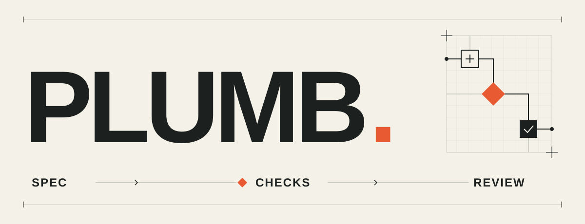

<p align="center">
  <picture>
    <source media="(prefers-color-scheme: dark)" srcset="assets/readme-hero-dark.svg">
    
  </picture>
</p>

<p align="center">
  <strong>From a brief to a reviewed change.</strong><br>
  Agree on the product. Freeze the contracts. Build against checks.<br>
  Keep the intent visible all the way to the final diff.
</p>

<p align="center">
  <a href="#start-a-change">Get started</a> ·
  <a href="#review-a-branch-or-pr">Review a branch</a> ·
  <a href="#how-it-works">How it works</a> ·
  <a href="#results-so-far">Results</a> ·
  <a href="#documentation">Documentation</a>
</p>

Plumb (named Software Factory until October 2026) is a set of agent skills, versioned documents and execution tools for software development. It asks the questions that change the product, turns the answers into contracts, and coordinates implementation, independent review and acceptance.

On the standard track, you approve one plan and sign off the result. An Opus 5.5 lead handles slices and scoped repairs, delegating bounded subtasks to Opus subagents when useful; an independent reviewer checks gate-green work. Changed promises, security decisions and missing authority come back to you.

**Status:** experimental. The existing workflow is implemented; the simplified Opus-led controller has not completed its end-to-end pilot. [Current capabilities ↓](#current-capabilities)

## Start a change

The primary setup is **Claude Code**, with **Git** and **Python 3.10+**. PR and headless workflows also use the GitHub CLI. Project runtimes and checks come from your repository.

```sh
git clone https://github.com/dogebonker/plumb.git
cd plumb
./bin/plumb-install HEAD

mkdir -p "$HOME/.claude/skills"
ln -s "$PWD/skills/plumb-init" "$HOME/.claude/skills/plumb-init"
ln -s "$PWD/skills/plumb-upgrade" "$HOME/.claude/skills/plumb-upgrade"
```

Then open the repository you want to change in Claude Code:

```text
/plumb-init
/plumb-triage Add a CSV export for the current filtered table
```

Init pins the framework and links its skills into that project. Enable the editing hook when init offers it; it guards the harness’s editing tools against unapproved or out-of-scope changes. Existing installations use `/plumb-upgrade`; [installation details](skills/README.md#install) cover setup and development links.

The skills use the open Agent Skills format. Automatic project linking currently targets Claude Code; other clients need manual integration. The standalone review skill also includes Codex metadata.

## How it works

### The questions become contracts

Who can export the table? Does the export include only visible rows? What happens if the data changes halfway through? These answers become requirements, examples and interface promises before implementation starts.

The standard-track loop:

<p align="center">
  
</p>

| Stage | What it leaves behind |
| --- | --- |
| **Plan** | Product rules, examples, architecture decisions, interfaces and scoped slices |
| **Build** | Tests, implementation and recorded verification for each slice |
| **Review** | Mechanical results, independently validated findings and acceptance evidence |
| **Reconcile** | The shipped decisions, constraints and vocabulary folded into living docs |

Questions start with a short reminder of what we're making and what's decided, so you can return after a break. Then a concrete scenario walks through where a person is, what they do and what happens, before asking what they should see or be able to do next. Behavior choices use plain words and visible flows, access tables or screen previews by default, with a recommendation and an easy A/B reply. Observed behavior and proposals are labeled separately. A small interface change does not automatically reopen compatible architecture or security decisions.

[Try three visual question examples](docs/examples/pre-build-questions.html): saving without a connection, who can open a shared note, and compact versus roomy screens. The preview's choices are illustrative and do not approve a project plan.

<details>
<summary><strong>How much process does a task get?</strong></summary>

| Track | Typical work | Process |
| --- | --- | --- |
| Trivial | A rename, copy change or one-line configuration edit | Direct execution |
| Small | A few files, no new interface | Slices, build and review |
| Standard | A feature, endpoint, screen or new interface | One combined plan, one approval, implementation and review |
| Critical | Money, existing access rules or migrations | Separate gates, explicit budgets and applicable risk reviews |

Risk controls verification. Design-book lenses are opt-in and sized to the task; required correctness, architecture, security and money checks remain.

</details>

### Architecture becomes something you can check

A constraint names its enforcement: a test, lint rule, architecture rule, monitor or human check. Accepted ADRs carry the same mapping. Review can cite **ADR 0007** with the same intent as a requirement ID or frozen signature.

Selected layout checkers enforce import boundaries. [Archgraph](https://github.com/dogebonker/archgraph) can supply cross-stack rules, blast radius and reading order; the repository stays readable beyond that initial context. Missing tools and incomplete graph coverage stay explicit.

The [shared archgraph adapter](skills/plumb-shared/archgraph.md#shared-adapter) now prepares bounded context for the Opus lead and reviewers, and checks new forbidden edges, cycles and unplanned edges when the approved layout selects it. Setup detects the pinned tool; context and gate reports bind the source, rules and binary. Helpers receive only their permitted context.

Approved documents are bound to exact hashes. When installed, the editing hook protects them and the current slice's allowed files. Supplemental evidence lives separately. Compatible unchanged approvals survive a revision; changed contracts need their actual decision. [Authority and limits](skills/README.md#hard-gates)

### Review checks both the code and its intent

Scanners and project checks run first. Reviewers inspect the behavior behind the contracts, trace side-effect ordering and validate findings against the code. Acceptance tries agreed examples on the running product.

A bounded review exercise caught a float conversion against an integer-money ADR and stayed silent on the conforming version. Its cost and limitations are [published](docs/research/intent-review-2026-10-19.md). That is a small behavioral check, not proof of general review quality.

## Review a branch or PR

You can use the review layer without starting a Plumb change:

```text
/plumb-code-review origin/main review
```

Pass a PR URL to review a pull request, or name code and documentation paths to narrow the scope. In Codex, invoke `$plumb-code-review` with the same request in prose.

The [review skill](skills/plumb-code-review/SKILL.md) combines:

- **Polish:** cleanliness, design/reuse, efficiency and side-effect gating.
- **Defect hunting:** installed scanners and the bug-review checklist, with concrete failure scenarios, severity and effort.
- **Plumb conformance:** docs, accepted ADRs, standing constraints, frozen contracts, ownership and approval integrity.

One shared packet and one deduplicated report. Small reviews stay lean; large reviews can split into four lanes. Fixes and PR posting follow explicit authorization. No new planning ceremony is required.

## Current capabilities

| Capability | Where it stands |
| --- | --- |
| Skills, versioned plans, editing hook, test-first slices and independent review | Implemented; primary project setup is Claude Code |
| Standalone code review | Implemented for local work and PRs |
| Headless runner | Implemented for a dedicated clone, with actual GitHub approver checks |
| Signed GitHub/Linear wake-ups | Local receiver and durable queue implemented; live subscriptions require setup |
| Opus 5.5 lead with bounded subagents, mechanical gates and independent review | Experimental v2 controller; native execution not yet validated; Glarity pilot not merged |
| Mid-build replanning | Budgeted v2 host checkpoint; proposals hold changed contracts for a decision |
| Durable v2 checkpoint recovery | Implemented and crash-tested through the host API; live provider restart unvalidated |
| Automatic queue recovery and Linear ticket admission | Pending integration |
| Shared Pond/archgraph context gateway | Design only |

The [v2 controller](docs/PLUMB_V2.md) reuses one Opus 5.5 lead session across slices and repairs in one isolated clone, with bounded native Opus helpers. It gates scope, frozen tests, types, lint, architecture and declared exports before a separate Opus review; each slice must clear its gates and independent review before the next slice starts. The [event-driven extension](docs/PLUMB_EVENTS.md) describes wake-ups, replanning, outcome metrics and the remaining integration work.

## Results so far

The sequential workflow, run under the Software Factory name, trailed both controls in the published **20-task, three-arm benchmark**:

| Arm | Accepted tasks |
| --- | ---: |
| Bare agent | **14 / 20** |
| Agent + a good CLAUDE.md | **14 / 20** |
| Sequential Plumb | **9 / 20** |

That is **45% accepted for Plumb versus 70% for each control: five fewer tasks, or 25 percentage points lower**. This measured the previous sequential workflow; it does not measure the current Opus-led simplification. Quality, tokens and wall time are reported separately; Plumb's incomplete cost accounting stays unknown. Raw artifacts were later deleted, which limits independent re-audit. [Full table, protocol and limitations →](docs/research/real-pr-benchmark-2026-10-19.md)

The [recovery and engineering-quality evaluation](docs/research/recovery-evaluation-2026-10-20.md) is in progress: all 20 tasks are recalibrated, with executable guarantee checks and separate architecture, rule-compliance and history measurements. The maintenance chain is reported; there is no new twenty-task acceptance result yet.

The next outcome is a merged, observed feature: **escaped defects per feature, time to recovery and adoption**, alongside cost and time. The [Glarity pilot report](docs/pilots/glarity-blog-seo/outcomes.md) currently records those outcomes as pending, not zero.

## Documentation

| Start here | Read for |
| --- | --- |
| [Skills](skills/README.md) | Commands, installation, hooks and headless operation |
| [Kit](kit/README.md) | Layouts, adapters, principles and pinned packs |
| [Design](docs/DESIGN.md) · [Decisions](docs/DECISIONS.md) | The specification and the reasoning behind it |
| [Plumb v2](docs/PLUMB_V2.md) · [Events and context](docs/PLUMB_EVENTS.md) | Experimental execution and the next integrations |
| [Benchmark](docs/research/real-pr-benchmark-2026-10-19.md) · [Changelog](CHANGELOG.md) | Measurements and changes |

## Built on

The four-gate approach draws from Dex Horthy and [HumanLayer](https://www.humanlayer.com/), including [Why Software Factories Fail](https://www.youtube.com/watch?v=Ib5GBkD555M). [Pond](https://github.com/tenequm/pond) supplies cross-session recall; [archgraph](https://github.com/dogebonker/archgraph) supplies architecture evidence. The standalone review adapts the user-supplied polish and bug-review workflows. Pinned third-party packs retain their own attribution.

[MIT](LICENSE). Bundled book rubrics retain their upstream [MIT notice](kit/packs/LICENSE.agent-rules-books).
