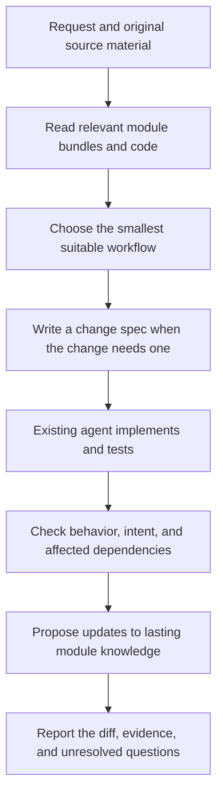

# Plumb: a skill for spec-driven development

Updated 2026-11-04. The [standalone skill](../skills/plumb/SKILL.md) is implemented,
alongside [Python tools](../plumb/README.md) for selected module imports, source
tracking, and guarded reconciliation. Broader reuse and productivity remain
validation targets, not established results.

Start with one skill for the existing coding agent. The skill teaches a reusable
way to select module knowledge, understand a request, plan a change, implement,
verify, and update knowledge. It does not need its own coding agent or runtime.

## What belongs where

| Part | Responsibility |
| --- | --- |
| Plumb skill | Instructions for choosing and following the development workflow |
| OKF bundles | Lasting module knowledge, current rules, rationale, and source references |
| Change spec | The requested behavior change, its design, tasks, and verification |
| Existing coding agent | Reasoning, implementation, tool use, and questions under its actual permissions |
| Existing Plumb commands | Repeatable snapshot, citation, source-version, and correction checks |

The workflow is a skill's content. OpenProse is an optional way to describe that
content when its execution benefits justify another format. A second language
is not a prerequisite for reuse across projects.

## The workflow

For a bounded change, keep its requirement, approach, and checks in one brief
note. For substantial behavior or cross-module changes, use Kiro's
requirements/design/tasks organization. Routine reversible work continues under the task authorization.
Ask about genuinely unresolved governing decisions or missing action authority.

A spec can derive from a selected Confluence page, Notion page, Linear ticket,
GitHub issue, repository document, or local export. Capture the material actually
read and its available revision. Identify applicable commitments and proposals;
a page is not automatically an approved requirement because of its title.
Live SaaS capture adapters remain future work. The skill can initially use
exports or available, authorized connectors.

A module bundle records current knowledge. A change spec records a proposed
delta. Do not update the bundle to claim planned behavior already exists.
Code observations, inferred intent, and explicitly agreed intent stay distinct.

## What we reuse

Kiro already combines change specs with persistent steering and explicit sync.
Borrow that organization and context selection. OKF adds a portable convention
for typed, linked knowledge with optional provenance and lifecycle metadata.
Neither guarantees semantic correctness. [Kiro Specs](https://kiro.dev/docs/specs/),
[Steering](https://kiro.dev/docs/steering/),
[maintenance](https://kiro.dev/docs/specs/best-practices/),
[OKF specification](https://github.com/GoogleCloudPlatform/open-knowledge-format/blob/main/SPEC.md).

Keep the existing Python checks when they save repeated work or enforce a useful
boundary. They protect operations routed through them; they do not sandbox the
host agent. `core.apply` is a single-file correction facility, not a multi-file
software-factory runner. Normal implementation uses an isolated worktree and
reviewed changes. [Core](../plumb/core.py#L347).

## What we defer

No new IDE, orchestrator, daemon, database, background index, automatic source
sync, or mandatory approval ceremony. No generic plugin system or provider
registry. Module boundaries and dependency links start explicit; imports alone
do not describe API, event, or shared-data dependencies.

OpenProse remains an optional, bounded experiment. Its skill execution depends
on host capabilities; Reactor is a separate alpha runtime. Neither has been
validated here. [Investigation](research/openprose-for-plumb-2026-11-04.md).

## Next evidence

Try the implemented skill on a real change. Reuse the same skill on another
project by changing only project inputs. Compare the total work, including
bundle maintenance, with the same agent given the same documents without Plumb.
Add code only for a recurring failure the skill cannot address reliably.

Keep execution serial, use targeted tests, and retain current workspace limits.
No further Claude CLI calls are authorized by this plan; the prior 12-call
allocation is exhausted. Resource and productivity advantages remain unmeasured.

[Implementation plan](../.omx/plans/plumb-spec-workflows-2026-11-04.md).
The [previous checker architecture](research/plumb-checker-architecture-2026-11-03.md)
and ADRs 0001–0006 are historical proposals.
