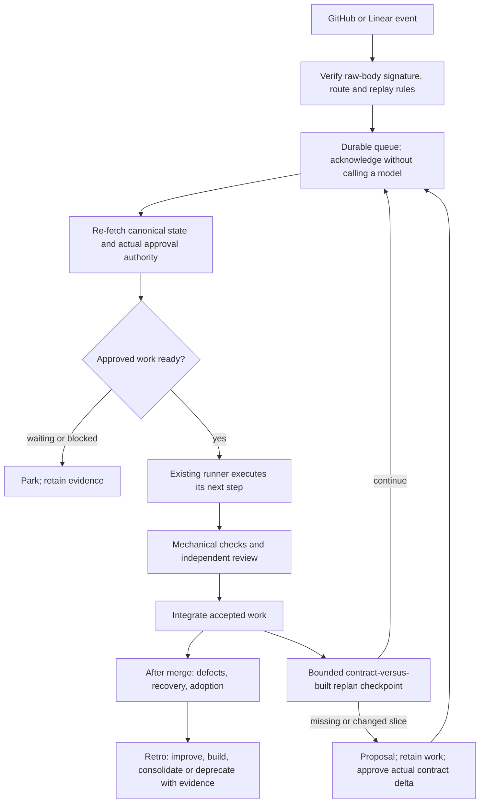

# Event-driven Factory and bounded replanning

This adopts the requested direction with an Opus 5.5 lead and bounded Opus subagents, without claiming unattended delivery is already shipped. Product remains the cold-start stage. Architecture enforcement remains mechanical. Outcome quality decides whether the extra machinery is useful.

## What exists

| Piece | State |
| --- | --- |
| GitHub/Linear signed webhook receiver, durable deduplicated queue | Implemented locally; no external subscriptions configured |
| Queued wake → existing headless runner → continue on verified progress | Implemented; retains GitHub approval/head provenance checks |
| Post-slice-integration v2 replanning checkpoint | Implemented host seam with opt-in approved allocation; no built-in native planner adapter |
| Escaped defects, recovery and adoption report | Implemented for explicitly supplied observations; production telemetry not connected |
| Skill deprecation proposals | Added to retro; retirement remains a human decision |
| Pond + archgraph context gateway | Interface design below; not an implemented server |
| Durable v2 checkpoint recovery | Host API implemented and crash-tested; original authority, bindings and budgets remain required |
| Queue-driven v2 recovery / Linear backlog-to-contract adapter | Pending integration; the receiver must not create a fresh v2 run per webhook |



The diagram is the target composition. The event bridge currently drives the legacy headless runner; the v2 checkpoint is separately callable inside one v2 run. They are not yet a durable distributed scheduler.

## Event bridge

`runner/factory_events.py` uses Python's HTTP server and SQLite. The receiver binds to loopback and admits only explicitly configured repository/workspace/project identities. Secrets come from environment variables named by server configuration, never payloads. Bodies are bounded, parsed only after HMAC validation, and not stored in the queue. Signature checks use the original bytes.

GitHub uses `X-Hub-Signature-256` (`sha256=` plus HMAC-SHA256) and `X-GitHub-Delivery`. Linear uses bare-hex `Linear-Signature`, `Linear-Delivery`, and its signed body `webhookTimestamp` within 60 seconds. Delivery ID/payload rebinding is rejected; a body digest also prevents replay by changing an unsigned delivery header. These follow [GitHub validation](https://docs.github.com/en/webhooks/using-webhooks/validating-webhook-deliveries) and [Linear webhook security](https://linear.app/developers/webhooks#securing-webhooks).

Acknowledgment follows durable enqueue, never model execution. Linear requires HTTP 200 within five seconds; GitHub requests 2xx within ten seconds. SQLite waits and request reads are bounded; this is not a measured production latency SLO. GitHub does not automatically retry failed deliveries, while Linear documents retries after 1 minute, 1 hour and 6 hours. Provide operator reconciliation for missed events; no claim of exactly-once external effects. See [GitHub best practices](https://docs.github.com/en/webhooks/using-webhooks/best-practices-for-using-webhooks), [GitHub failed deliveries](https://docs.github.com/en/webhooks/using-webhooks/handling-failed-webhook-deliveries), and [Linear delivery behavior](https://linear.app/developers/webhooks).

A minimal operator-owned route configuration:

```json
{
  "project-github": {
    "provider": "github", "repository_id": "123456",
    "repo": "/srv/factory/project", "approvers": ["actual-human-login"],
    "secret_env": "FACTORY_GITHUB_WEBHOOK_SECRET", "max_steps": 32
  },
  "project-linear": {
    "provider": "linear", "repository_id": "123456",
    "organization_id": "workspace-uuid", "project_id": "project-uuid",
    "repo": "/srv/factory/project", "approvers": ["actual-human-login"],
    "secret_env": "FACTORY_LINEAR_WEBHOOK_SECRET", "max_steps": 32
  }
}
```

Run the receiver and worker as separately supervised processes, with the same private state path and route configuration:

```sh
python3 runner/factory_events.py serve --db /srv/factory-state/events.sqlite --config /srv/factory-state/routes.json
python3 runner/factory_events.py worker --db /srv/factory-state/events.sqlite --config /srv/factory-state/routes.json
python3 runner/factory_events.py status --db /srv/factory-state/events.sqlite
```

Endpoints are `/hooks/project-github` and `/hooks/project-linear`. Production needs an operator-configured HTTPS ingress, secrets and subscriptions; Linear refuses localhost/non-HTTPS subscriptions. None are configured by this change. Use a dedicated clean runner clone with installed pinned framework, runtimes and scoped credentials as the existing runner requires. The worker verifies the clone's GitHub repository ID against the route before dispatch. Route fingerprints bind queued work to the exact operator configuration; changed routing/approvers park old work instead of redirecting it.

`factory_run.py --report <outside-clone-artifact>` exposes `progress`, `busy`, `waiting`, `blocked`, `idle` or `failed`. Only successful trusted changed-head progress schedules the next pass; unchanged success is idle. Busy work backs off. Pending events coalesce while preserving the greatest continuation step and delay. Each chain stops at `max_steps`; it is a loop bound, not a token/spending cap. Existing approvals, native usage receipts and recovery artifacts remain the source of execution evidence. A failure parks already-pending events rather than immediately replaying ambiguous work. An interrupted `running` job is not reclaimed automatically, even when another event arrives: inspect retained work and external state before operator recovery. No job-status field grants approval.

The bridge does not create tickets, approve code, merge main or post messages. Linear events currently wake the configured repository's approved Factory work; they do not prove a ticket's dependencies are clear or turn a ticket body into an executable contract.

## Linear readiness and durable v2 admission: next adapter

Before claiming ticket-driven slices, add an explicit mapping of stable issue ID → plan digest → slice ID, plus a trusted project execution mandate. On a wake, re-fetch the current Linear issue, paginated relations, blocker states and matching GitHub/source revision; event ordering and a completed label are not authority. Only `state.type == completed` satisfies completion by default; canceled/duplicate blockers require the project's actual policy. Incoming `blocks` relations identify blockers; an outgoing completion can wake dependents. Do not substitute the first page of relations or HTTP 200 with GraphQL errors for full evidence. See [Linear GraphQL](https://linear.app/developers/graphql), [pagination](https://linear.app/developers/pagination), and the [pinned relation schema](https://github.com/linear/linear/blob/785d7bb6a7c51542e35acfaf34e73faf73b867b7/packages/sdk/src/schema.graphql#L21023-L21047).

The durable scheduler must persist accepted commits, pending/running slices, ownership leases, actual attempts/review passes, native invocation identities, spent budgets, approval bindings and the replan frontier. It must validate these against current Git/provider state before resuming. A webhook cannot launch a fresh `run_change` with a new directory to reset counters. Legacy and v2 use different repository locks today; never schedule them against the same repository concurrently. Wire one execution lane per repository until lock/state ownership is unified. Periodic canonical reconciliation covers dropped deliveries and relation-only changes; do not infer that Linear provides a dedicated relation webhook.

## Mid-build replanning

Existing approved v2 plans are unchanged by default. Opt in with an approved top-level allocation:

```json
"replan_budget": {"tokens": 100000, "seconds": 120, "max_calls": 4}
```

These are example allocations, not recommended budgets. They fit inside the feature's overall allocation and affect the plan digest. The trusted host supplies `replanner(root, packet, remaining_budget)` to `run_change`. The packet contains the exact source/plan/tool binding, accepted slice IDs/commits and a diff-stat summary capped at 8,192 characters. Give the provider read-only access to relevant contracts and implementation; a diff stat is navigation, not semantic evidence. Compare what was built against current contracts, dependency assumptions and missing end-to-end paths. Zero actionable proposals is valid. Reuse context; no whole-project brainstorming or new methodology.

Return exactly:

```text
{binding, decision: continue|propose,
 proposals: [{slice_id, reason}], events: actual_native_events,
 native_list_cost_usd: observed_native_cost}
```

At most three proposals name a missing/new or affected slice and concrete evidence in `reason`. The callback is a trusted host seam, not a built-in model adapter: it must enforce its own read-only sandbox and timeout. The controller checks mutation/bindings, native Opus 5.5 receipts, distinct invocation sessions and observed time/token/call limits. Replan spend joins feature totals and any explicitly approved Opus share ceiling. New Opus-led plans omit that ceiling; older approved limits remain binding. Unknown usage blocks further execution; costs are not inferred from token counts.

After every accepted local integration, `continue` allows the next existing frontier. `propose` writes an artifact and returns `awaiting_replan`; no altered contract executes automatically. Accepted commits remain retained in the single isolated clone. Later slices continue in the same lead session after gates and independent review. Within the active slice, the lead may delegate bounded subtasks to Opus helpers. A revised plan needs only actual changed contract/scope decisions; compatible architecture/security approvals are not reopened for ceremony. [Same-plan host recovery](FACTORY_V2.md#recovering-an-interrupted-run) preserves the original authority and budgets; it does not authorize a new plan. Final merge remains separate.

## Outcomes, baseline and deprecation

Record **confirmed post-merge defects per fully observed feature**, detection-to-recovery with unresolved incidents right-censored, and adoption with a named successful event/eligible population. Use the same declared observation window and attribution rules across controls; incomplete monitoring is unknown. The [Glarity outcome sheet](pilots/glarity-blog-seo/outcomes.md) is pending because it has not merged. Gate failures are diagnostics, not a substitute for escaped defects.

The existing [historical benchmark](research/real-pr-benchmark-2026-10-19.md) remains the honest control: bare and good CLAUDE.md each accepted 14/20, sequential Factory 9/20. This does not establish the simplified Opus-led mode's quality; its native session reuse has not yet been validated live. Keep quality comparisons separate from cost/wall time; no inference rerun or favorable reclassification. That study did not observe production defect rate, recovery or adoption.

Retro can propose improving, creating, consolidating or deprecating a skill. Deprecation requires evidence, active consumers, replacement/migration and rollback, human approval, and preserved historical pins. Low invocation count alone does not prove obsolescence. Context views can expire or supersede lessons; immutable Pond transcripts remain available as historical evidence.

## Shared context gateway: proposed Pond interface

Pond already exposes `pond_search`, `pond_get_session`, `pond_get_message`, `pond_sql`, `schema://pond`, `schema://pond-sql` and `stats://pond`. Archgraph already supplies context and architecture evidence. Reuse those backends; do not copy transcripts into a second memory store or pretend these read tools already provide typed writes. This design belongs at the Pond boundary; this change edits no Pond repository/server.

One gateway serves the lead and its helpers, Factory reviewer and a future Slack bot with the same response schema:

| Proposed surface | Purpose |
| --- | --- |
| `context://capabilities` | Actual backend versions, supported tools, navigation guidance, freshness, read/write capability and limits; no assumed tools |
| `context_query(project_id, revision, intent, changed_files, budget, cursor?)` | Route historical recall to Pond, current code/impact to archgraph, current intent to versioned docs; return a bounded reading plan |
| `context_expand(reference, budget, cursor?)` | Expand a cited message/file/evidence item without loading an entire session first |
| `context_propose_entry(type, source_slice, evidence, expires, supersedes?)` | Propose decision/constraint/failed_approach/spec_defect/outcome; actual write/adoption requires the existing human decision and scoped write authority |

A response carries schema version, canonical project ID, requested/observed source revision, backend/version, retrieval time, ordered items with exact source references, evidence confidence/status, omissions/cursor and estimated returned tokens. Missing/stale backends remain explicit. Separate current accepted intent from historical or expired interpretations; session prose never supersedes an ADR. Keep raw provenance and tool navigation common across clients. Cache keys include project, source revision, authorization scope, query and backend/index revision; no stale graph may claim a current snapshot.

Initially, the trusted context builder can consume this gateway and assemble the
existing read-only worker/reviewer packets. Direct worker MCP access stays denied
until explicit typed read methods and project/revision scope checks are added;
installing a gateway never enables a blanket tool or write permission.

Project/requester identity comes from authenticated transport, not a caller-supplied path or a Slack message. Authorize access before retrieval/expansion and enforce project/tenant boundaries server-side; Pond's substring `project` search filter is not an access-control boundary. The Slack client gets its own constrained read capability, never the lead's write credentials or arbitrary SQL access. Retrieved prompts/logs are untrusted content. Creating tickets, posting messages and adopting lessons are separate authorized mutations, not side effects of asking for context. No Slack bot or MCP write endpoint is enabled here.
