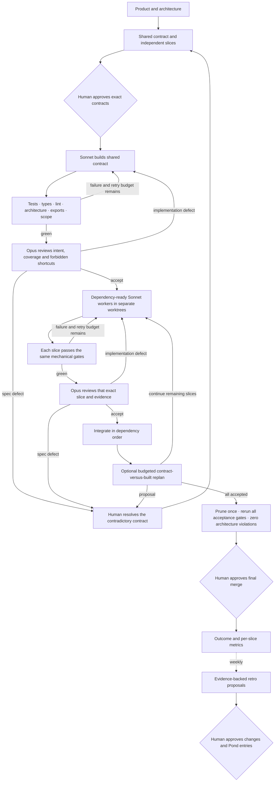
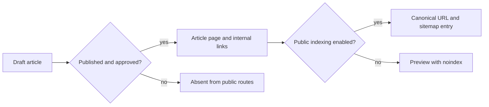

# Factory v2: contracts, workers and mechanical gates

The v2 controller is experimental. The local scheduler, worktree isolation, contract
validator, scope guard, gates and bounded review loop exist. A real Glarity pilot
has not yet passed them or been merged. The existing Factory remains the default.

The [event-driven extension](FACTORY_EVENTS.md) adds a local GitHub/Linear receiver
and queue for the existing headless runner, an optional v2 post-integration replan
checkpoint, post-merge outcome reporting, and a proposed shared context gateway.
It does not yet supply durable event-by-event v2 resume or a Linear ticket adapter.

Within an approved contract, gate failures and review repairs consume the slice's
retry budget without another architecture or security approval. An interface,
ownership or frozen-scenario change needs a revised contract. Exhausted budgets
stop the run with the evidence; they do not authorize a weaker check.

The scheduler builds the shared contract first. Three or more independent ready
feature slices run concurrently; fewer run serially. Every slice has its own
worktree. The original checkout and its uncommitted changes are preserved.

## What the human sees

Questions explain an actual decision in product terms, with one concrete example
and its consequence. There is no preselected answer. A diagram is useful when a
choice changes a flow or a boundary; it is unnecessary for a naming correction.

For example, a blog publishing decision can show:

The accompanying explanation names the decision: whether publishing makes an
article discoverable by search engines, or keeps it available only as a preview.
It states the trade-off and what can be changed later. It does not ask the human
to choose a framework, review passing lint output or repeat an unchanged approval.

## Contract and evidence

`kit/v2_contract.py` validates `plan.yaml` and `slices/<name>.yaml`. These files use
strict JSON, a YAML subset, so the runner needs no YAML dependency. Unknown fields,
duplicate keys, unsafe paths, conflicting ownership, dependency cycles and
contradictory export signatures are rejected before execution.

Each slice declares interfaces, frozen BDD scenarios, applicable NFR thresholds,
layout rule IDs, public surfaces, exclusive `owns`, permitted `reads`, dependencies
and budgets. Paths are exact files or directories ending in `/`; globs are not
ownership boundaries. TypeScript signatures are type expressions checked by the
installed compiler, rather than string comparisons with generated declarations.

The controller supplies actual `archgraph context` and `explain --brief` output,
plus repository instructions. It does not assume a nonexistent `--for-agent` flag.
Unsupported context, incomplete symbol proof or unavailable isolation stops before
review. Workers use the builtin Read, Grep, Glob, Edit and Write tools under the
same ownership, read scope and frozen-file guard. Reviewers receive read tools
only. Unknown MCP tools and stale source-tool policy fields are denied.

`kit/v2_gates.py` runs test, typecheck and lint commands in a native macOS sandbox.
It additionally checks scope, frozen bytes, new architecture violations/cycles and
the complete declared TypeScript export surface. Final gates run the union of
acceptance scenarios and require zero architecture violations/cycles.
An approved `policy.final_test_gate` can run the complete scenario set against the
merged feature, replacing the isolated test commands while retaining types, lint
and architecture checks. It must report every frozen scenario ID.

Commands, source, scenarios, layout, dependencies, compiler and tools are bound to
the evidence. A later edit invalidates that evidence. A test runner reports executed
frozen scenario IDs as `{"case_ids":["..."]}`. An NFR runner reports actual finite
measurements as `{"nfr":{"criterion-id":123}}`; thresholds currently mean
“at most.” Test chatter belongs in separate logs.

Test commands receive one assigned TCP loopback port as `FACTORY_TEST_PORT`.
Other local services and external endpoints are denied. Port reservation still has
a race. Process timeouts terminate the leader and its current process group;
detached descendants can survive. This macOS sandbox enforces file/network access,
not a hard descendant-lifetime or CPU limit. A strict hostile-code execution
boundary would require a container or VM. Frozen pilot tests retain and clean up
their child processes.

Only green evidence reaches the Opus reviewer:

1. Is the interface intent matched?
2. Are the functional requirements covered, without gaming the tests?
3. Are there shortcuts the specification should have forbidden?

Verdicts are `accept`, `reject` with a concrete repair, or `spec_defect` for the
human. Review is bound to the exact source and gate evidence, with a maximum number
of passes. A source mutation during review prevents integration.

## Running and measuring

Validate a proposal with `python3 runner/factory_v2.py validate PLAN`. A trusted
host invokes `run_change` only after observing human approval of that exact plan
digest. JSON approval files, booleans and status text do not grant authority. The
current approval seam is a host attestation, not a native cryptographic signature.

The run directory retains contracts, model packets, native usage, gate logs,
structured failures, reviews, isolated worktrees and the integration result.
`python3 runner/factory_v2.py report RUN_DIR` reads measured counters. Missing
provider usage remains unknown; cached input and output remain separate token
classes. Native list cost is separate from an invoice or subscription charge.

Opus must account for at most 25% of observed feature tokens. Admission checks use
observed token budgets and hard invocation timeouts; the native CLI does not prove
a hard total-token ceiling. Token padding does not establish efficiency.

A missing prune callback leaves the run at `awaiting_prune`; it cannot offer a final
merge. Final merge needs separate approval bound to its exact SHA. This controller
does not push, deploy or modify the original main branch.

Planner/replanner and weekly retro provider adapters, approved typed Pond writes,
durable v2 resume, a shipped pilot and the same-feature cost comparison remain to
be demonstrated. The historical three-arm benchmark is now published; it does not
establish that this experimental swarm improves quality.
