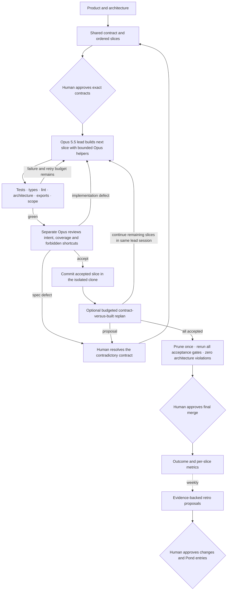
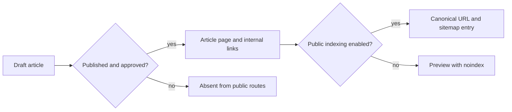

# Plumb v2: an Opus lead, bounded helpers and mechanical gates

The v2 controller is experimental. It reuses one Opus 5.5 lead session across
dependency-ordered slices and repairs in one isolated clone. The lead may delegate
bounded subtasks to native Opus helpers, including useful parallel subtasks.
Mechanical gates precede a separate independent Opus review; each slice clears
that barrier before the next slice starts. Contract validation, scope guards and
bounded repair/review remain.
The simplified mode has not been validated with a native model run; the Glarity
pilot has not passed end to end or been merged. The skills remain the default entry point.

The [event-driven extension](PLUMB_EVENTS.md) adds a local GitHub/Linear receiver
and queue for the existing headless runner, an optional v2 post-integration replan
checkpoint, post-merge outcome reporting, and a proposed shared context gateway.
V2 now supplies checkpoint recovery through its trusted host API. Automatic queue
recovery and a Linear ticket adapter remain separate integrations.

Within an approved contract, gate failures and review repairs consume the slice's
retry budget without another architecture or security approval. An interface,
ownership or frozen-scenario change needs a revised contract. Exhausted budgets
stop the run with the evidence; they do not authorize a weaker check.

The controller builds the shared contract first, then executes one dependency-ready
slice at a time, regardless of slice count. There is one isolated clone for the
feature, with no prescribed Sonnet worker pool, concurrency threshold or parallel
worktrees. Helper delegation remains available inside the current slice. The
original checkout and its uncommitted changes are preserved. The native adapter starts the implementation
lead with an explicit `--session-id` and uses `--resume` for later slices and repairs;
it stops if that session cannot be verified instead of silently replacing it.
The read-only reviewer uses separate context and runs after the gates.

## What the human sees

Questions explain an actual decision in product terms, with one concrete example
and its consequence. There is no preselected answer. A diagram is useful when a
choice changes a flow or a boundary; it is unnecessary for a naming correction.

For example, a blog publishing decision can show:

The accompanying explanation names the decision: whether publishing makes an
article discoverable by search engines, or keeps it available only as a preview.
It states the trade-off and what can be changed later. It does not ask the human
to choose a framework, review passing lint output or repeat an unchanged approval.

## Contract and evidence

`kit/v2_contract.py` validates `plan.yaml` and `slices/<name>.yaml`. These files use
strict JSON, a YAML subset, so the runner needs no YAML dependency. Unknown fields,
duplicate keys, unsafe paths, conflicting ownership, dependency cycles and
contradictory export signatures are rejected before execution.

Each slice declares interfaces, frozen BDD scenarios, applicable NFR thresholds,
layout rule IDs, public surfaces, exclusive `owns`, permitted `reads`, dependencies
and budgets. Paths are exact files or directories ending in `/`; globs are not
ownership boundaries. TypeScript signatures are type expressions checked by the
installed compiler, rather than string comparisons with generated declarations.

The controller supplies actual `archgraph context` and `explain --brief` output,
plus repository instructions. It does not assume a nonexistent `--for-agent` flag.
The everyday skills now use the [shared adapter](../skills/plumb-shared/archgraph.md#shared-adapter)
for the same pinned tool's context and regression evidence. The controller keeps
its separate scoped context filter and sandboxed gates; attaching a whole-root
MCP server would not preserve a helper's declared read boundaries.
Unsupported context, incomplete symbol proof or unavailable isolation stops before
review. The lead uses the builtin Read, Grep, Glob, Edit and Write tools and may
call the pinned native `plumb-helper` through Agent. Helpers inherit Opus 5.5
and the current slice's ownership, read scope and frozen-file guards. They cannot
run in the background or create nested agents. Parallel helpers must have bounded,
nonconflicting assignments; their usage is included in feature totals and existing
token/time budgets. Reviewers receive read tools only. Unknown MCP tools and stale source-tool policy fields are denied.

`kit/v2_gates.py` runs test, typecheck and lint commands in a native macOS sandbox.
It additionally checks scope, frozen bytes, new architecture violations/cycles and
the complete declared TypeScript export surface. Final gates run the union of
acceptance scenarios and require zero architecture violations/cycles.
An approved `policy.final_test_gate` can run the complete scenario set against the
merged feature, replacing the isolated test commands while retaining types, lint
and architecture checks. It must report every frozen scenario ID.

Commands, source, scenarios, layout, dependencies, compiler and tools are bound to
the evidence. A later edit invalidates that evidence. A test runner reports executed
frozen scenario IDs as `{"case_ids":["..."]}`. An NFR runner reports actual finite
measurements as `{"nfr":{"criterion-id":123}}`; thresholds currently mean
“at most.” Test chatter belongs in separate logs.

Test commands receive one assigned TCP loopback port as `PLUMB_TEST_PORT`.
Other local services and external endpoints are denied. Port reservation still has
a race. Process timeouts terminate the leader and its current process group;
detached descendants can survive. This macOS sandbox enforces file/network access,
not a hard descendant-lifetime or CPU limit. A strict hostile-code execution
boundary would require a container or VM. Frozen pilot tests retain and clean up
their child processes.

Only green evidence reaches the Opus reviewer:

1. Is the interface intent matched?
2. Are the functional requirements covered, without gaming the tests?
3. Are there shortcuts the specification should have forbidden?

Verdicts are `accept`, `reject` with a concrete repair, or `spec_defect` for the
human. Review is bound to the exact source and gate evidence, with a maximum number
of passes. A source mutation during review prevents integration.

## Running and measuring

Validate a proposal with `python3 runner/plumb_v2.py validate PLAN`. A trusted
host invokes `run_change` only after observing human approval of that exact plan
digest. JSON approval files, booleans and status text do not grant authority. The
current approval seam is a host attestation, not a native cryptographic signature.

The run directory retains contracts, model packets, native usage, gate logs,
structured failures, reviews, the isolated clone and the integration result.
`python3 runner/plumb_v2.py report RUN_DIR` reads measured counters. Missing
provider usage remains unknown; cached input and output remain separate token
classes. Native list cost is separate from an invoice or subscription charge.

### Recovering an interrupted run

The host calls `resume_change(..., run_dir=original_run_dir)` with the original
approval source and unchanged plan, tools, callbacks and read-only inputs. The
repository registers that plan to its first run directory; choosing another
directory cannot reset spending. Approval JSON and checkpoint files do not grant
approval authority.

An atomic checkpoint and hash-chained journal retain accepted commits, the lead
session, elapsed time, usage, retries and review passes. Verified completed work
is reused. Recovery rechecks state under the execution lock and deduplicates
receipts and events across tested crash windows. It can adopt an already-created
commit only when its exact parent and contents match the saved evidence.

An incomplete native invocation without a verified result, a corrupt journal,
changed bindings or an interrupted arbitrary callback holds the run for recovery.
The controller does not start a replacement session or replay an ambiguous paid
operation. Crash regressions exercise this behavior; live provider restart
recovery has not been validated.

New plans omit `opus_share_limit`: the lead, its helpers and independent review use
Opus 5.5, so a 25% Opus share is incompatible with this execution mode. Existing
approved plans that explicitly set a share ceiling retain it; the controller does
not silently relax their contracts and stops before implementation instead of
paying for an Opus-only run that cannot meet that ceiling. A revised plan needs approval of that actual
budget change before it can run under different limits. Frozen pilot plans stay
as historical artifacts.

Resumed native usage can be cumulative. The collector includes child-agent usage
and records invocation deltas for tokens and native list cost, rather than counting the full session again on
every slice. Unknown or unverifiable token usage stops execution; missing cost
receipts stay unknown rather than becoming zero.
Admission checks use observed token budgets and hard invocation timeouts; the
native CLI does not prove a hard total-token ceiling. Native list cost is not an
invoice or subscription charge, and no cost saving is claimed without measurement.

A missing prune callback leaves the run at `awaiting_prune`; it cannot offer a final
merge. Final merge needs separate approval bound to its exact SHA. This controller
does not push, deploy or modify the original main branch.

Planner/replanner and weekly retro provider adapters, approved typed Pond writes,
live recovery validation, a shipped pilot and the same-feature cost comparison remain to
be demonstrated. The historical three-arm benchmark is now published; it does not
establish that this Opus-led simplification improves quality. Native session
reuse, measured cost and a shipped pilot still need live validation.
