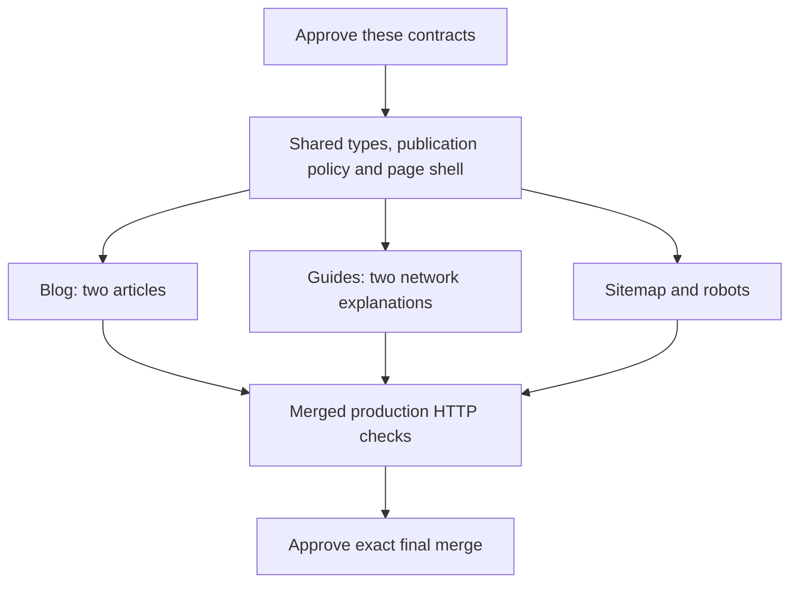

# Glarity: blog and programmatic SEO pilot

**The first shared-contract trial stopped at its approved retry limit.**
The [benchmark report](../../research/real-pr-benchmark-2026-10-19.md) is published.
No blog, guide or discovery worker has started. A [bounded recovery proposal](amendments/publication-recovery/README.md)
has passed native mechanical preflight and awaits its separate recovery allocation.

Four curated educational pages, two indexes and a small home page will make seven
public routes. The articles explain swap status and deposit-address checks; the
guides cover USDT on Ethereum/Tron and USDC network selection. Full proposed copy
and primary sources are in [editorial.json](editorial.json).

Preview stays **noindex** with an empty sitemap. Only an explicit valid HTTPS
publication origin plus the indexing flag enables public canonicals and sitemap
entries. No production deployment, rates, fees or live availability claims.

Each worker passes tests, typecheck, lint, architecture, export and scope checks
before Opus reviews it. Passing checks and repairs within these contracts continue
automatically. Spec defects return to the human. Final merge remains separate.

| Slice | Exclusive ownership | Depends on |
| --- | --- | --- |
| [Shared contract](slices/contracts.yaml) | `lib/content.ts`, `lib/publishing.ts`, root layout/home/CSS | — |
| [Blog](slices/blog.yaml) | `app/blog/` | Shared contract |
| [Guides](slices/guides.yaml) | `app/guides/` | Shared contract |
| [Discovery](slices/discovery.yaml) | `app/sitemap.ts`, `app/robots.ts` | Shared contract |

All paths are under `apps/frontend`. The shared contract freezes before the three
independent feature workers start. No backend, admin, dependency or deployment
files are worker-owned. Frozen editorial content and twelve executable BDD cases
cannot be changed by workers. Final acceptance checks all seven routes and links.

Read [product intent](product.md), [architecture](architecture.md),
[public interfaces](program-design.md), and the complete [plan](plan.yaml).

Validation binds this exact proposal to:

- Plan SHA-256: `dfd5835434b9016842642a8dbac5b3a97e0e2b3b6aa5682487b65add9f4a12f6`.
- Prepared local base: `d39b64d28e863aada0c2b27defc6df7ddb208453`.
- Glarity main used for preparation: `fbb2e4fa6161456a3e9365333942e7f1551150fa`.

The prepared base adds the frozen prose, content, rules and acceptance runner,
and applies your explicit removal of the former code-tool integration. Project
knowledge remains in ordinary Markdown. It implements no application feature.
The original dirty Glarity checkout received only the requested tooling cleanup.
The approved plan validates structurally. Lint, typecheck and production build
pass on the existing frontend; the new HTTP tests correctly fail on its missing
navigation. A real architecture scan covers 26 baseline files with zero forbidden
edges/cycles. These are preflight results, not a passed pilot.

The observed-token ceiling is 3 million for the run, one repair retry per slice,
at most two review passes, and Opus at most 25% of total tokens. These are limits,
not measured cost estimates. Usage and native list cost will be reported separately;
missing usage cannot establish the ratio. No tokens are padded to satisfy it.

The macOS gate sandbox limits file/network access and gives tests one assigned
loopback port. Port reservation has a race; detached processes can outlive cleanup.
Frozen tests explicitly retain/stop their children. This is local development
isolation, not a hard hostile-code process/CPU boundary.

Contract approval authorizes local worker execution against the exact plan above.
It does not authorize a push, production publication, indexing configuration or
final merge. The historical three-arm benchmark must also be published before a
new Factory skill is introduced.

The original contract approval remains valid as amended by your subsequent tool-removal instruction. Product, ownership, interfaces, tests and budgets are unchanged.
