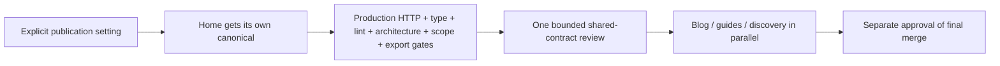

# Publication recovery proposal

**Approval pending. No new model calls have started against this proposal.**

The public-mode setting was omitted from the worker's contract prose. The frozen
checker expected `BITX_MARKETING_PUBLIC_ORIGIN`; the worker's repair selected
`BITX_MARKETING_PUBLICATION_ORIGIN`. The valid publication test therefore stayed
in preview/noindex. The approved one-repair budget stopped the run.

The recovery names the existing setting, removes the guessing, and checks that
404 responses carry no canonical and remain noindex. Home supplies its canonical
using React's hoisted link; its export contract stays unchanged.

**Architecture, public interfaces, ownership, read permissions, editorial content,
and dependency versions are unchanged.** This asks for a bounded recovery, not
another architecture or security approval.

## Budget

| Measured before deletion | Recorded value |
| --- | ---: |
| Native calls | 5: two planner, two Sonnet worker, one Opus review |
| Tokens | 868,340 |
| Opus tokens / share | 203,020 / 23.38% |
| Native CLI list cost | $1.6123413 |

The user deleted the private raw artifacts after these measurements. Those
figures are retained as reported observations, not recreated native receipts.
The original frozen pilot inputs have been recovered byte-for-byte; three owned
implementation files were recovered from their original tool outputs. The small
content module and stylesheet were reconstructed. New evidence lives in durable
private storage outside `.tmp`. The benchmark will not be rerun.

The original feature ceiling stays **3,000,000 tokens / 5,400 controller seconds**.
The remaining plan permits **2,131,660 tokens / 4,844 seconds**.
The shared-contract recovery gets one worker invocation, no retry, at most
134,680 tokens, and one review at most
69,162 tokens. These are the remaining balances
of explicit cumulative shared-worker / reviewer allocations of 800,000 / 200,000.
The three feature-slice budgets remain unchanged. All earlier measured cost stays
in the feature report; deleted raw evidence remains an audit limitation.

## Reviewable inputs

- [Proposed plan](plan.yaml), [product](product.md), [program design](program-design.md).
- [Shared contract](slices/contracts.yaml); other slices in `slices/` retain their exports and ownership.
- Plan SHA-256: `b3cc1a18113e2f8ed16800fd8eb3d3f317339a8c816ae617c70af6997c428e4f`.
- Prepared local base: `e1acb9ac937e104e57b285b352c715a18c48c228`.

Native preflight **passes**: production HTTP checks (including 404 metadata),
typecheck, lint, architecture, scope and compiler-backed export checks.
The architecture binary was restored from the current local build and pinned as
`c79ae7bc8ba819acba5c1729a1d14de7a22f654cdd84f80482f7a5bf86d19272`; it passed this preflight.
The native prune preflight also passes: Next.js type generation and TypeScript's
unused-symbol checks run on an archived copy without mutating source. This does
not claim CSS pruning. The launcher self-check and seven synthetic tests pass; execution remains blocked
until an actual recovery approval is wired by the host.
No push, deployment, indexing change or final merge is authorized by this proposal.
