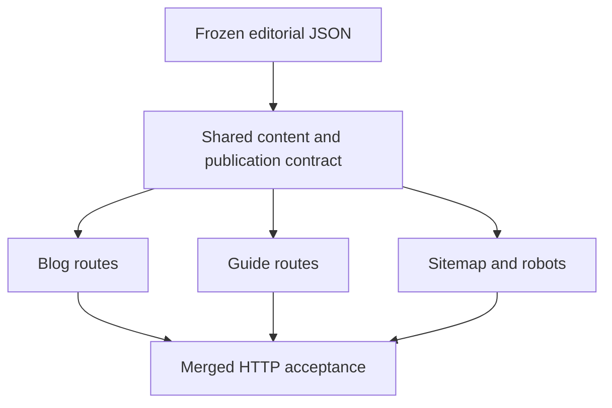

# Independent marketing slices

The contract slice owns the content types/inventory, publication policy, metadata
function, home, shared layout and stylesheet. Its exports and all of its accepted
bytes freeze before the other three slices begin. It imports no feature module.

Blog, guides and discovery depend only on the contract slice. Discovery reads the
frozen shared route inventory; it does not import or inspect unfinished feature
implementations. It may list those future routes in its isolated tests. The final
merged HTTP test must prove every inventoried route and internal link resolves.

All code stays under `apps/frontend`; backend, admin, deploy, credentials and
dependency files are outside worker ownership. `layout.yaml` forbids feature cross
imports, contract-to-app imports, root-to-feature imports and frontend imports into
private systems. Unplanned existing imports are not relabeled as constrained.

The narrow layout `include` triggers this archgraph version's full-repository TS
discovery. Without it the Python `src/` directory produces an empty TS scan. A
verified baseline covers 26 files including frontend and admin, with zero forbidden
edges/cycles. The gate additionally requires every owned and contract TS file to
appear in the scan; an empty scan cannot pass through compiler proof.

TypeScript's pinned compiler proves complete owned export inventory and signature
compatibility. Archgraph supplies import/cycle evidence and its limited symbol
observations. Partial native symbol coverage is recorded, not treated as complete.
Owned JavaScript files are unsupported until equivalent compiler proof exists.

Workers use normal file tools guarded by `owns`, `reads` and frozen inputs.
Read, Grep and Glob inspect approved context; Edit and Write change owned files.
Shell execution and MCP tools are denied. Project guidance lives in ordinary
Markdown under `docs/agents`.

Mechanical commands use a copy with read-only source/dependencies and approved
derived output directories. HTTP tests receive one assigned loopback port. Other
host services and external networking are denied. A port reservation race remains;
macOS timeouts clean the leader/current process group, not detached descendants.
The frozen runner never detaches its children and explicitly stops/awaits them.
This is not a hard hostile-code CPU or descendant-lifetime boundary.

No original checkout edits, remote push, final merge or deployment are automatic.
The human approves these contracts, any subsequent spec defect, and the exact final
merge. Passing checks and repairs within the contracts need no repeated approval.
