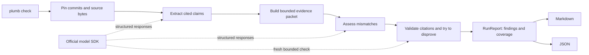

# Plumb: architecture for a clean-slate intent checker

Historical proposal, 2026-11-03. The evolving implementation now lives in the
[reconciliation prototype](../../plumb/README.md); its module-bundle workflow and
[2026-11-04 milestone](../../evals/intent_pilot/module_source_milestone/RESULTS.md)
supersede the delivery assumptions below. The proposed diff-based API is not shipped.

Build one local Python CLI with a fixed, bounded review workflow. Its product is a small, versioned Claim/Finding contract: show the stated intent, the contradictory code or source, and the question a person must resolve. Keep the existing factory in history; write the verifier afresh.

The first delivery step is the contract and a held-out evaluation set, followed by a baseline. The old intent exercise contains two tiny revisions in one model call; it cannot establish the new product's accuracy. The factory's 9/20 versus 14/20 result measures building software, not detecting intent drift. [Existing evidence](intent-review-2026-10-19.md), [factory benchmark](real-pr-benchmark-2026-10-19.md).

## Open assumptions and the first trials

These are planning assumptions pending your constraints, not commitments or measured performance:

1. **Provider:** start with Anthropic's official Python SDK, with a fake model function for deterministic tests. Run a one-day compatibility trial covering structured output, refusals, truncation, timeouts and usage. Ship the provider only if every failure stays distinguishable from a complete review; otherwise keep the same core and use schema-validated raw responses through the SDK. Select the actual model through evaluations.
2. **Privacy:** assume source may leave the machine only after the operator explicitly configures a provider. If source must remain local, release waits for a locally hosted model to pass the same suite; there is no silent cloud fallback.
3. **Envelope and delivery:** assume one maintainer, one check at a time, small/medium changes and a four-week experimental release. A 20,000-path repository is acceptable; a review packet must fit the bounded context. Larger changes can return incomplete. The detailed targets and cost arithmetic are in [the forces and validation appendix](plumb-intent-forces-2026-11-03.md).

## What Pond recovered

Your latest saved direction was a minimal shell-friendly checker: `plumb check [base..head]`, Markdown by default and JSON for automation, plus `plumb skill`. Initial intent sources are repository docs/ADRs and an explicitly supplied PR body. Findings cite both sides and propose **code wrong**, **spec stale**, or **sources conflict**; a person decides the resolution. You explicitly removed MCP, hosted service and automatic code fixing. Your correction in this session makes this a **clean-slate implementation**, retaining only necessary evidence and assets.

Recall source: Pond session `59e32a8f-3678-4fea-a523-b0c4a9e326ba`, user message `57fda574-a0fc-4535-90a6-be429923d3aa`, 2026-11-01. The pasted conversation first proposed MCP and more integrations, then explicitly narrowed them away. No external connector is needed to read those sessions at runtime.

## Decisions

- **D01:** one synchronous Python CLI, because the constraints call for a shell tool and the bottleneck is model work, not CPU or service scaling. [Record](../adr/0001-local-cli.md)
- **D02:** model evidence and unresolved intent explicitly; use a small domain model for citation/authority invariants and a plain use-case function for orchestration. [Record](../adr/0002-intent-and-evidence.md)
- **D03:** Git objects and supplied source bytes are authoritative inputs; all extracted claims and findings are derived per run, with no database. [Record](../adr/0003-snapshots-and-state.md)
- **D04:** keep policy independent from Git, the model SDK and rendering, using a few functions and records rather than an extension framework. [Record](../adr/0004-module-boundaries.md)
- **D05:** extract, assess and try to disprove in a bounded workflow; adopt retrieval or extra agents only after a controlled evaluation earns them. [Record](../adr/0005-model-workflow.md)
- **D06:** ship Markdown/JSON and honest coverage/status semantics; preserve the old factory separately and gate the new release on evaluation evidence. [Record](../adr/0006-delivery-and-interfaces.md)

## The runtime

There is one deployed package/process, no server, queue or persistent index. Only the CLI writes its requested output; it never changes reviewed source or specs. Git and the model endpoint are its runtime integrations. The optional supplied PR-body file avoids GitHub credentials, API permissions and fetching in the first version.

The workflow first fixes the review range and reads committed blobs. It inventories source passages and extracts normative claims, then presents relevant code together with surrounding intent, exceptions and authority metadata. Candidate findings pass deterministic evidence checks before a fresh, narrow disproof call. An incomplete call or unread material becomes a coverage gap, never a clean result. A fresh disproof prompt is an error-reduction technique, not an independent proof of correctness.

Start with all selected intent in the packet when it fits. Read code beyond the changed lines when needed to trace callers and guards. If the packet cannot contain the declared scope, report the omitted scope or ask for a narrower invocation. Do not conceal truncation with a confident summary. An explicit relevance selection is itself recorded and evaluated; it does not justify claiming a whole-repository audit.

## The schema is the product

[The proposed contract](../intent-spec.md) defines Source, Claim, Finding and RunReport. A source has immutable content identity, revision and authority metadata. A claim retains its exact passage and context. A finding references validated evidence and contains a mismatch explanation, a proposed origin and one resolution question.

For example: “The ADR says refunds return to the original card; this changed branch returns store credit. Should the implementation follow the ADR, or has the refund policy changed?” A source conflict requires two contradictory passages; a mismatch requires code evidence too. An unsupported origin remains unresolved rather than forcing one of the three answers. Missing intent is a coverage gap, not an invented fourth type of defect.

Exact quotes establish that evidence exists. They cannot establish that a passage applies, that the execution path is reachable or that the model understood the behavior. Those questions need semantic evaluation and human review. Citation validation also accepts **base-revision evidence for deleted code**; a blanket “every line must exist at HEAD” rule would miss deletions.

## Boundaries and ownership

| Capability | Classification | Owner and shape |
| --- | --- | --- |
| Intent, applicability, authority and mismatch evidence | Core | `intent.py`: immutable records and validation of meaningful combinations |
| Review a fixed change and report uncertainty | Core | `check.py`: one use-case function, explicit phase outcomes and budgets |
| Snapshot and source acquisition | Supporting; integrity-critical | `snapshot.py`: Git blobs, supplied bytes, path/type/size checks |
| Model protocol translation | Generic | `model.py`: one official SDK adapter, strict response validation |
| Command parsing and report formatting | Generic | `cli.py` and `render.py`: two output functions over one report |
| Evaluation | Supporting; release-critical | `evals/`: frozen public fixtures, held-out cases and reproducible scoring |

This is a proposed module map, not a mandate to create every file before a walking skeleton. Each record and function must earn its place. No generic repository, event bus, service container, provider registry or source plugin API is required. Keep module dependency checks small and local; enforce them in CI when those modules exist.

## Delivery sequence

Build in separately verifiable slices: contract and evaluation labels; read-only snapshot and renderer; naive model baseline; validated assessment; candidate disproof; packaging and CI dogfood. Each slice has observable completion and rollback in D06. Start with 40 development cases; prepare 200 total cases split by repository before making comparative accuracy claims. Keep the old factory out of the new package and out of the verifier's test command.

The shell is the agent interface. `plumb skill` prints instructions for invoking the CLI and interpreting incomplete results. CI initially invokes the same command and uploads JSON/Markdown as artifacts. SARIF, a dedicated Action, external document connectors, an index and structural code analysis each need a measured user need before entering the product.

## Research and pattern review

[The tool study](plumb-intent-tool-landscape-2026-11-03.md) compares runtimes, source navigation, retrieval, model integrations and output formats against official sources. [The pattern review](plumb-intent-patterns-2026-11-03.md) examines a bounded part of the existing implementation and distinguishes real findings from ideas for nonexistent new code. Neither authorizes refactoring or porting the factory.

This task creates design/research documents only. No factory files, branches, tags, source code or package dependencies are changed.
