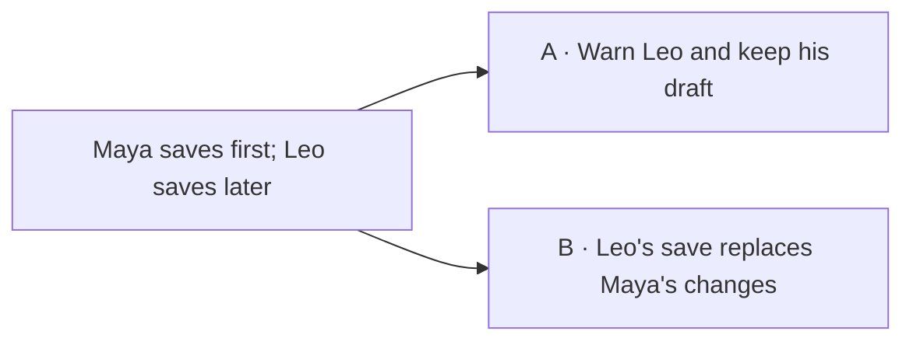

# Plumb gates

Shared rules for every Plumb skill. Plumb skills install as a set, so this file sits next to them. Paths are relative to the repository root; `<change>` is `.plumb/changes/<slug>`.

## Paths

- `<project>` is the `.plumb` folder at the repository root: `system/` (living documents), `changes/` (one folder per change), `runs/ci/`, `runs/ui/`, `runs/security/` and `runs/prune/` (run outputs), `plumb.lock`, `principles.md` (the project's principles and quiet rules) and `evals/` (the project's own eval cases).
- The framework cache is `~/.plumb/framework/<commit>/`: `kit/`, `skills/`, `hooks/` and `bin/` of one Plumb commit, unpacked once per machine by `bin/plumb-install` in the Plumb repository. Projects never edit it. Book rubrics also ship under `<kit>/packs/<name>@<hash>/`; packs.md resolves a matching bundled pin before the shared cache.
- The pack cache is `~/.plumb/packs/<name>@<hash>/`: one folder per pinned pack and hash, shared by every project on the machine that pins that hash, filled by `bin/plumb-packs-fetch` from bare mirrors in `~/.plumb/packs/.mirrors/` ([packs.md](packs.md)). Projects never edit it.
- `<kit>` is `~/.plumb/framework/<commit>/kit`, where `<commit>` is `framework.commit` in `<project>/plumb.lock`, or `<dev_path>/kit` when the lock names a `dev_path` (Resolve `<kit>`, below).
- The user layer is `~/.plumb/user/`: `principles.md`, the user's taste across projects, and `config.yaml`, whose `framework_repo:` is the local clone of the Plumb repository, used to show the log between two framework commits (Load a change) and by `/plumb-packs` to bump the framework's pins.
- **Principle layers.** Principles and quiet rules load in three layers: `<kit>/principles.md` (framework defaults), then `~/.plumb/user/principles.md`, then `<project>/principles.md`; a missing file is skipped. A later layer wins on the same `<lens>/<rule>`: a project Principle whose Source is a `<lens>/<rule>` that a lower layer lists under Quiet rules takes that rule out of Quiet rules. Money and security rules never go quiet in any layer: rules from a `fin-*` pack, and rules that guard authentication, authorization, secrets, injection, cross-site attacks or path traversal.

`<project>/plumb.lock` pins what the project runs on. `/plumb-init` and `/plumb-upgrade` write it; every other skill only reads it.

```yaml
framework: { commit: <sha>, installed: <ISO date> }
packs:                                                                # copied from <kit>/packs.lock.yaml at init or upgrade
  <name>: { source: ..., path: ..., hash: ..., pinned_at: ... }       # one line per pack; `packs: {}` when there is none
skills_linked: [.claude/skills]                                       # where /plumb-init linked the skills
```

To develop Plumb itself, `framework` may instead be `{ dev_path: <absolute path to a Plumb checkout> }`.

**Resolve `<kit>`.** Every skill does this before it reads anything else from the lock or the kit:

1. `framework.commit: <sha>`: `<kit>` is `~/.plumb/framework/<sha>/kit`, the skills folder is `~/.plumb/framework/<sha>/skills/`, and `<running>` is `<sha>`.
2. `framework.dev_path: <path>`: `<kit>` is `<path>/kit`, the skills folder is `<path>/skills/`, and `<running>` is `git -C <path> rev-parse HEAD`.
3. A branch that still has `.software-factory/` or `.factory/` and no `.plumb/`: say "this branch still uses <that folder>/; run /plumb-init to migrate it", and stop. No `plumb.lock`, no cache folder for its commit, or no `dev_path` folder: say which, point to `/plumb-init`, and stop. When `.claude/settings.local.json`, `.claude/settings.json` or `~/.claude/settings.json` runs a `hooks/factory_gate.py`, say "this checkout still runs the hook from before the rename, which does not gate .plumb/; run /plumb-init to repoint it", and stop.
4. The `realpath` of this gates.md, as you opened it, must be inside the `realpath` of that skills folder. Otherwise name the commit or path actually running (the folder that holds its `skills/`) and stop: the linked skills are not the locked framework.

## The chain

| Gate | Document | Skill | Line budget |
| --- | --- | --- | --- |
| product | `<change>/01-product.md` | `/plumb-product` | 120 |
| architecture | `<change>/02-architecture.md` | `/plumb-architecture` | 150 |
| interface | `<change>/03-interface.md` | `/plumb-interface` | 200, or 250 when it designs a frontend root (plumb-interface, step 2) |
| slices | `<change>/04-slices.md` | `/plumb-slices` | 100 |

Track standard drafts and approves all four documents together through `/plumb-plan`, in interactive mode.

Gate states: `pending`, `approved`, `skipped`. Track `small` skips product, architecture and interface; triage marks them `skipped`.

`hash(doc)` = `shasum -a 256 <doc> | cut -d' ' -f1`

`status.yaml` keeps each gate and slice as a one-line flow map (`{ id: 1, name: tracer, state: pending }`). The Plumb hook (`hooks/plumb_gate.py` in the Plumb repository) reads them that way to block source edits the gates do not allow.

## IDs

- An FR's example is the `Example:` line indented under it. Older documents give it its own bullet (`- Example:`); read both.

- `FR-NN`, `NFR-NN`, `C-NN` belong to one change and are defined in its gate documents.
- `SYS-FR-NN`, `SYS-NFR-NN`, `SYS-C-NN` are standing rows in `.plumb/system/constraints.md`. A change lists the ones it touches under Standing constraints in its first gate document, then treats them like its own IDs: a budget or ruled-out options in architecture, an enforcement in interface Coverage, a covering slice.

## Layout

A change's Layout is the Layout section of `02-architecture.md` together with the module's tree in `.plumb/system/layout.md`. Under each module, lines come in one group per root, headed `Pattern: <id>, root: <path>, check: <tool or none>`: the reference layout from `<kit>/layouts/index.yaml` (or `<host>+cqrs`, or `existing` for a tree recorded as it is), the folder it was laid out for, and its checker from `<kit>/layouts/tools.yaml`. A line names a folder or a file, relative to the module path, and says what lives there; `<name>` matches one folder name, and `{a,b}` matches either. A file fits the Layout when any of these admits it:

- a line names the file, or names a folder the file is in or below
- the file sits directly in a folder that held tracked files at `change_base_commit`, and no line names that folder or a path directly inside it
- the file sits in a test tool's folder (`__snapshots__`, `__mocks__`) directly inside a folder the first two admit files in

## Milestones and autopilot

A milestone is a group of slices reviewed and completed together (with PR sign-off in headless mode): the `Milestone` line of each original slice in `04-slices.md`, copied as `milestone` into its `status.yaml` entry. A validated derived correction has its own next unused milestone in status, without changing that approved document. A slice without one is its own milestone, and so is every slice in headless mode. A milestone's work is its slices that are not `done`; `M` is its number, or the slice id when the slice has none.

In interactive mode the conductor follows build and review directly: prepare one bounded packet at a time, retain one Opus 5.5 lead across slices and repairs, allowing bounded native subagents for independent approved work, perform mechanical checks, and dispatch one fresh independent read-only general reviewer per milestone plus applicable risk specialists. Route all routine source/test fixes to the existing implementation executor as one bounded validated finding batch; when the session itself is the implementation executor it writes code and records mechanical evidence; a separate conductor validates actual native outcomes when delegation occurs. Neither duplicates the independent reviewer's whole-file pass. No additional step-agent wrapper is mandatory. Read relevant failure tails and packet inputs; keep complete logs in artifacts rather than repeating broad source reads.

1. Load the change, re-reading `status.yaml` before each decision/write. Unapproved gates or `sent_back` stop at the appropriate gate. Build the next open slice, review when all open milestone slices are `green`, then reconcile when all are `done`.
2. Observe actual native terminal results for every dispatched executor/reviewer and any children before consuming their evidence. A progress message, output file or resumable task is not completion. Validate returned commits, exact artifact paths and current-source proof directly; the conductor alone records its checks/status. Do not synthesize child completion for conductor work or demand that an executor claim conductor-owned `green` status.
3. Existing genuine step-agent callers retain the native handoff contract below; removing the default wrapper does not waive it for a wrapper that actually ran. Such a child returns an identity-free JSON report under the change: `state: completed|question|blocked`, `children: [{id, state}]` for actual children, `status_sha256` of final status bytes, exact existing `artifacts`, and the entire `question` when stopped. It waits for its children and reports only its own work; it never infers native routing identity.

   Consume the native task completion or question event for the dispatched agent; a message saying a child is still running is not completion. Wait through the native task API, never a shell sleep/file-existence loop, and do not guess a root `review.md` when the child returned `slices/NN/review.md`. The child must not infer its native agent/task identity. After consuming the actual native return, the parent writes a separate completion envelope with `task_id` (its dispatch token), `agent_id` (the observed native task id), `state: completed` (from the task API), and `children: [{id, state}]` from every actual child task result. Check those native states against the identity-free child report; a running task is not a completed envelope. Child-supplied routing fields are ignored. Validate the report with `python3 <kit>/runtime.py handoff --repo <repo> --report <returned JSON path> --completion <parent completion envelope path> --slug <slug> --task-id <dispatched task id> --agent-id <native agent id> --slice <NN> --expected-state <green for build, done for signed-off review>`. A review awaiting sign-off returns `question`, not `completed`. Failure: resume that exact agent with the validation error; if it is gone, recover from disk through the same skill. Do not advance or invent state to match a report. Task identities and the file hash are routing/snapshot evidence, never approval authority; the existing user approvals and edit hooks still apply.
4. Real requirement/authority questions are shown whole and actual answers passed verbatim. Resume the same agent for repairable failures. Retry counts are diagnostic; preserve dirty/untracked work and commits. Neither a task identity, hash, status label nor telemetry supplies approval authority.
5. Append one `step_tokens` event with actual agent ids and normalized usage; do not count nested rollups twice. Continue directly under approved scope, unless `--one-step`, manual pause or a genuine blocker stops execution.

**Fast lane.** Track standard, interactive mode: one milestone, slices built serially in dependency order in the deliverable checkout, under the same Opus 5.5 lead while its context remains safe. The lead may delegate independent bounded subtasks within the active slice in parallel, with explicit non-overlapping write ownership. No prescribed Sonnet worker-per-slice swarm or automatic parallel worktrees. Wait for a genuinely dispatched executor's native terminal result; the current session's own work needs direct commit/check evidence, never an invented task return. Slices stay `green` after review. A filled Completion under approved scope in `slices/<last>/review.md`, backed by applicable passing mechanical/review/acceptance evidence, marks review as finished, so a resumed session goes to reconcile, not to review again. In item 1, "reconcile when all are done" reads, for the fast lane, "reconcile when all are green and review is finished". Handoff validation still applies to genuine delegated wrappers; usage accounting applies to every track.

**Serial review barrier.** Finish the current milestone's independent review, validated repair batch and affected checks before starting the next milestone. Do not create `review_overlapped` events or background a review to build ahead. Existing events, worktrees and retained commits are recovery evidence: wait for actual live tasks, preserve all work, complete the older review at a quiet point and reverify affected retained slices before advancing. Never discard a later slice merely to restore serial order.

Except on the fast lane, initial slices approval must explicitly authorize bounded local implementation, executable-test correction under unchanged promises, review repairs and automatic intermediate completion. Existing plans use actual session authorization, never an inferred state flag. Interactive `green -> done` requires that real approval, independent current-source review and passing mechanical proof. Record `Completion under approved scope` with the original approval reference separately from the empty final `Sign-off`; never invent a human signature. One final real decision at reconcile covers acceptance, held review items and document drafts. Headless approval and sign-off derivation remain unchanged.

`--one-step` runs exactly one slice or milestone review, then reports the next skill and stops. A user's manual pause is honored. Contract changes, waivers, unrelated scope, destructive actions, credentials, security/money outcome decisions and publication still need the appropriate authority. Completed slices remain edit-locked. An unchanged-criterion acceptance defect uses the authorized derived-correction branch below only when all its conditions hold; other corrections use the existing genuine approval path, never silent rehashing.

## Commits

- Code commits per slice are the executor's red and green commits, plus a fix commit for each validated review repair batch. Previously created worker commits retain their integration history; new serial slices need no worker merge commits.
- Interactive committed mode: build and review do not commit `.plumb/` as separate steps. The planning state goes into the milestone review's first commit, and reconcile commits the rest. Gate approvals, send-backs and reconcile still commit.
- Headless mode commits and pushes after every step, since each run starts from a fresh clone. When `PLUMB_RUNNER_MANAGED=1`, commit locally and omit every skill push: the runner disables the clone's normal origin push URL (a publication policy, not network isolation) and publishes only a clean, successful, trusted step. Timeout, setup failure, nonzero exit or invalid head retains the full clone under the runner's `.git/plumb-recovery/`; its checkpoint identifies the trusted starting head. Recover locally from that clone, preserving dirty/untracked files and commit history; do not publish or reset failed work merely to resume.
- A commit that fails to sign: ask the user to unlock their signing agent, then retry. Never commit unsigned.

## Load a change

0. Resolve `<kit>` (Paths). On failure, stop as it says, before the version check reads the lock.
1. Slug empty: a gate skill uses the sole unreconciled change on the current branch, including one whose gate is already approved, so resume can advance without replay. Several: ask which change. None: report no active change rather than inventing one or requesting approval again. Build and review use the rule they state.
2. Read `status.yaml`. Check out its `branch`. Append a `step_start` event to `history` (History, below).
   **Plumb version.** A change runs on the framework commit it started on. When `factory_commit` is missing or differs from `<running>` (Paths, Resolve `<kit>`), the framework changed under this change: show `git -C <repo> log --oneline <factory_commit>..<running> -- :/skills :/kit`, where `<repo>` is the `dev_path` checkout, or else `framework_repo` from the user layer's `config.yaml` (when neither is set, or that clone lacks either commit, say so and skip the log), add every field of the triage template's `status.yaml` that this file lacks, with the value triage would set now (asking the user where triage would ask), then set `factory_commit` to `<running>` and append a `factory_updated` event. When no field is missing, the check asks nothing. A start state built for a test or an eval writes a `plumb.lock` whose framework commit is its `factory_commit`, so the check stays silent. A headless runner runs this check like any session; a question it needs waits on the pull request like any other.
3. **Check the chain.** Walk the gates in order and compare approved documents with their recorded hashes. If a mismatch is solely your own incidental rewrite or appended progress/evidence, recover the exact approved bytes from an identified approval snapshot and verify the recorded hash before continuing; never overwrite a user's edits or guess semantic equivalence. If the snapshot or edit ownership is uncertain, preserve both versions and report that precise blocker. Otherwise the changed gate becomes `pending`; apply **Change impact** below to its dependents before resetting their approvals. Append a `gate_reopened` event with cause `chain` and show the concrete decision diff. Never update an approval hash merely to accept a rewrite. Headless mode retains the full downstream reset and PR snapshot checks.
4. **Resume, do not replay.** A gate skill whose own gate is `approved` with a matching hash, or `skipped`, does no drafting, enrichment, research, challenge panel or approval question. Continue automatically to the next unfinished stage, under Run the next skill; only an explicit manual pause or `--one-step` stops at the hand-off. Approved documents stay byte-for-byte unchanged. A genuinely needed revision is proposed separately with its decision diff and affected promises; actual user authorization to revise opens the relevant gate before agent edits. A user's direct document edit still follows the chain check.
5. **Design file.** A change with `ui: true` in `status.yaml` needs the repository's design file: the root `DESIGN.md`, or `.plumb/system/design.md` when the root name holds something else; either way it carries the stamp `factory:design-schema` that `/plumb-ui-ux` writes. Without it, every skill stops and points to `/plumb-ui-ux design-md`; the Plumb hook blocks source edits too.
6. A gate skill drafts only when every earlier gate is `approved` or `skipped`. Otherwise name the first gate that is not, and its skill. Stop. Build and review need all four `approved` or `skipped`.
7. **Playbook.** Read `.plumb/system/playbook.md` as [playbook.md](playbook.md) says, when it exists.

`/plumb-plan` differs at three steps. Step 4: when all four gates are `approved` with matching hashes, it continues directly to unfinished build/review/reconcile work. Step 5: it does not stop for a missing design file, because it writes one; the hook still blocks source edits until then. Step 6: it drafts the pending documents in order, so an earlier pending gate does not stop it.

## Development proof inputs

On the fast lane (Milestones and autopilot), Change impact invalidates the checks/review/acceptance evidence of affected non-done slices, including callers and shared-state dependents; unchanged coverage is reusable only when its criteria, source, commands and environment still apply. Build reverifies those slices before completion. A retained architecture/security approval never makes stale implementation proof current. The detailed input manifests below remain for the other tracks.

Before selecting or skipping a build/review slice, compare every non-`done` slice's packet and receipts against the current genuinely approved gate documents and referenced inputs. Record an `Inputs` manifest in the packet/checks/review: exact path and SHA-256 for each non-skipped gate document, plus the source documents/files supplying applicable criteria, SYS promises, budgets, signatures, layout, design, rules, pack pins, adapter and verification commands. Mark skipped gates explicitly. Hash immutable input files in full. For mutable metadata such as `status.yaml` or mixed `lenses.yaml` records, capture exact effective fields/values or hash their canonical projection: commands, baseline exclusions, applicable module/layer/pack settings and verification environment. Exclude history, slice progress/commit checkpoints, completion records and the receipts themselves; source revisions remain separate proof. A progress write must not invalidate evidence, while a changed command, baseline, tool/dependency/environment or effective rule must. Matching Covers IDs or unchanged source alone is insufficient; compare the copied promises and effective rules too.

A missing manifest, changed input hash, or mismatched copied criterion/budget/signature/rule invalidates prior checks and review coverage for that non-done slice. Retain old packets/receipts as historical artifacts and append the invalidation reason to history. Refresh the packet from genuinely approved current inputs and set an affected retained-work slice to `building` (a slice without work stays `pending`) before selection, even if it was `green`. Preserve base/test/head commits and all source; reverify and repair only demonstrated mismatches, rather than rebuilding code automatically. New checks and independent review must record the refreshed input manifest before `green`/`done` or sign-off. Do not reapprove a changed gate or reuse an old receipt by merely updating its hashes.

For retained-work repair, preserve each slice's original `base_commit`, `test_commit`, head and receipts in its packet/check history before updating current status. Record its original owned commit span and each repair's start HEAD and exact correction commit span in packet/checks; this is provenance, never authority. Check the original slice-owned span and new repair spans separately against that slice's Allowed files. Do not treat unrelated later slices between the original base and current HEAD as its edits, add their files as deviations, or erase them. Current contracts, corrected-test expectations and GREEN still apply at current HEAD. The final milestone check uses the complete milestone history against the union of its packets. If ownership cannot be established from recorded commits/receipts, report the gap rather than invent a span.

A `done` slice remains edit-locked. If new approved inputs affect completed work, hold that impact for explicitly authorized corrective scope; never reopen it or treat its old review as proof of the new promises. Headless APPROVED-review derivation is unchanged.

## Autonomous local corrections

Interactive mode, not on the fast lane. New interactive `04-slices.md` plans include this mandate before actual approval:

```markdown
## Development
Mode: autonomous-local
Repairs: approved-slice-files
```

Actual initial approval of those bytes authorizes within-contract corrections confined to the selected original slices' exact Allowed files, including their planned test paths. It never authorizes changing approved document bytes, weakening criteria/contracts, or reopening completed parents. Legacy/missing-mandate plans and headless PR approvals retain their existing route; explicit manual pauses and `--one-step` still apply. A status/hash/record is provenance, never independent authority.

After independent acceptance reproduces a defect against an unchanged approved criterion, append one ordinary correction at the next unused slice ID and new milestone. Its original parents must remain `done`; preserve their base/test/head receipts and all four approved documents and hashes. Batch related failures in one consolidated change-local failure file. Derive scope only from the original headings, Covers and exact Allowed files in frozen `04-slices.md`, never mutable packets or prior corrections. A correction cannot parent another correction. No new-file, regression-test or typecheck deviation widens this scope: use existing planned test paths or the genuine slice approval path.

### Repair record and proof inputs

Write `<change>/slices/NN/repair.json` with exactly this shape (replace placeholders with actual hashes):

```json
{
  "id": 3,
  "branch": "plumb/example",
  "parents": [{"id": 1, "head_commit": "<40-hex>"}],
  "criteria": ["FR-01"],
  "approved_docs": {
    "product": "<64-hex>",
    "architecture": "<64-hex>",
    "interface": "<64-hex>",
    "slices": "<64-hex>"
  },
  "start_commit": "<40-hex>",
  "paths": ["src/store.py", "tests/test_store.py"],
  "failure": {
    "path": "acceptance/failure-01.md",
    "sha256": "<64-hex>",
    "source_commit": "<40-hex>",
    "criteria": ["FR-01"]
  },
  "proof_inputs": {"path": "slices/03/inputs.json", "sha256": "<64-hex>"}
}
```

Every field is required; reject additional fields and duplicate JSON keys at every level. IDs are positive JSON integers, never booleans; directory names use at least two digits. Commit IDs are lowercase 40-hex and SHA-256 digests lowercase 64-hex. Other strings and arrays are nonempty. IDs and normalized paths are unique. The ID matches the status row/directory and is the next unused ID at creation. Every parent is an original approved heading, remains `done`, and its fixed status head equals the recorded `head_commit`. `criteria` is a unique subset of those parents' Covers; `failure.criteria` equals that set. `paths` is a unique subset of the union of their original exact Allowed files.

`approved_docs` has exactly the four gate keys. Slices is always the digest of genuinely approved status and unchanged mandated `04-slices.md` bytes. Product/architecture/interface each match genuinely approved status and bytes, or are JSON null only for an existing legitimate skipped gate on track small. Pending gates, missing approval evidence and null-for-approved substitutions fail. Criteria text comes from original small-track Requirements/Examples, or original approved FR/NFR and applicable standing criteria on standard/critical tracks.

Status must explicitly record `mode: interactive`; missing mode or headless mode cannot use this branch. `branch` equals both attached Git branch and status branch. Parent heads are ancestors of `start_commit`, which is an ancestor of actual HEAD. Failure source is a committed tested ancestor of start with no intervening source changes (planning-only commits allowed). At creation source/index/untracked source are clean and HEAD equals start. Never reset this baseline on resume.

Evidence references are change-relative POSIX paths to existing regular files inside this exact change. Source/input paths are repository-relative POSIX paths. Reject absolute paths, empty/dot/dot-dot segments, backslashes, globs, NULs, symlinks at any component and resolved escapes; hash bytes without following symlinks. Source paths cannot target `.git`, `.factory`, `.software-factory`, `.plumb` or `DESIGN.md`. No receipt path authorizes arbitrary host reads.

The referenced immutable input snapshot has exactly this JSON shape:

```json
{
  "criteria": [{"id": "FR-01", "text": "<verbatim approved fit criterion>"}],
  "files": [{"path": "<repository-relative effective input>", "sha256": "<64-hex>"}],
  "commands": ["<exact applicable verification command>"],
  "environment": "<recorded tool/runtime/dependency environment identity>"
}
```

All fields are required with exactly these types and keys; apply the same strict duplicate/string/array/digest/path rules. Criterion IDs and file paths are unique; criteria IDs equal repair criteria and text matches original approved criteria. The conductor supplies the complete applicable Development proof inputs inventory: criteria/budgets/signatures/rules, relevant configuration and dependency manifests. Reuse captured manifests and immutable repository/change-local snapshots when bytes and effective contents still match. Needed external rules use a bounded repository-local snapshot, not an external receipt path or a recopied whole book. Exclude the receipt itself and mutable repair source files; actual commit/diff checks bind source revisions. Commands and environment are comparison strings, never executed by the validator. The conductor verifies applicability, current environment and complete coverage: byte hashes do not prove the truth of command/environment claims. A changed/missing effective input requires a new retained receipt, explicit reference update and fresh affected proofs, without changing approved hashes or scope. Missing historical receipts are not current proof.

Paths are literal filenames: framework route names such as `app/tickets/[id]/page.tsx` are allowed as exact paths, never expanded as patterns. `*` and `?` remain forbidden. Source inventory uses tracked and nonignored-untracked Git paths; ordinary ignored build/dependency artifacts do not become repair scope.

### One validator, two checkpoints

Resolve `<plumb-root>` from the locked `<kit>`'s parent, containing `hooks/`. Use only the existing shared read-only hook validator:

```sh
python3 <plumb-root>/hooks/plumb_gate.py repair-check --repo <absolute-repo> --change <slug> --slice 03 --checkpoint edit
python3 <plumb-root>/hooks/plumb_gate.py repair-check --repo <absolute-repo> --change <slug> --slice 03 --checkpoint complete
```

The fixed repo/change/slice selects the record; do not accept an arbitrary metadata path or add another parser/engine. Checkpoint is exactly `edit|complete`. Success exits 0 with `repair scope valid`; failure exits 2 with a specific stderr reason. Existing stdin PreToolUse behavior stays intact. These checks prove structural scope/provenance, never approval, review or quality/completion.

Both checkpoints validate mandate, gates, strict record/inputs, paths, branch and ancestry. Reject duplicate/malformed original declared slice IDs and unsafe original scope paths; never infer a parent from a corrective status row alone. Inspect every source path touched by every commit reachable in `start_commit..HEAD`, per-parent diffs for merges with rename detection disabled so added/deleted/renamed/copied endpoints all count. A forbidden edit followed by revert fails. Include staged, unstaged and untracked source using NUL-safe Git output; Git read failure fails closed. Metadata exemptions do not widen source scope or bypass the four document hashes. The validator executes no receipt commands and writes no Git/config/status/source.

- `edit`: permits clean state or interrupted owned changes only inside exact record paths; the hook also checks the requested edit path. Unrelated dirty/staged/untracked source blocks: preserve and report it.
- `complete`: additionally requires clean source index/worktree, no untracked source, and the correction's recorded head equal to HEAD or separated only by planning commits. Existing isolated RED/GREEN, actual native completion for any dispatched executor/reviewer (direct source/check evidence when the current session implements), independent current-source general/risk review and applicable mechanical/acceptance proofs remain mandatory and conductor-owned. A control-file exemption is not completion proof.

Creation order: establish actual interactive authority and independently reproduced unchanged-criterion failure; capture clean start and immutable failure/input evidence; write only control artifacts first: record, candidate derived packet and pending status with `base_commit: <start_commit>` and null test/head; validate record and packet together via `edit`; then set building and dispatch. Do not require an already validated packet before its initial candidate exists. Invalid staged metadata stays blocked without altering parents or approved docs. Run `edit` on every resume and immediately before edits/dispatch. Run `complete` after review fixes and before recording completion, alongside actual proof checks. For mandate-bearing plans, every undeclared active ID requires valid repair metadata even if no repair flag was written.

Automatically continue validated corrections through build, independent review and independent acceptance until the complete current required matrix passes, honoring manual/one-step preferences. Changed source reruns affected and shared-state criteria; reuse only applicable current-source/current-input evidence. Not-run, timeout and setup error are never passes. Repeated identical failures trigger one bounded evidence-based diagnosis, then an authorized recovery or precise blocker; no retry-count permission handoff, endless full panels, whole-source rewind or deadline quality waiver. Real contract, waiver, security/money outcome, credential, destructive or publication decisions keep their existing gates. Final human reconciliation remains separate from technical success.

## Change impact

Interactive mode: approval belongs to a decision, not to a turn through the stage list. Before Send back or a chain reset, compare the concrete proposed/current delta with approved requirements, architecture decisions/budgets, interface promises, slice scope and the security model. Record a compact table in change-local `impact.md`: gate/model, `revise | retain | uncertain`, changed IDs/signatures, reason and exact approved references/hashes. Bind it to the changed document's before/after hashes and relevant source commit as well as each retained document's digest. If the final approved delta differs, reassess compatibility before dispatch. Reuse applicable review findings instead of launching another full panel. This is compatibility evidence, never a new approval or authority to change approved bytes.

- Reopen the document that actually changes and any dependent whose promises or assumptions the delta contradicts. Preserve each byte-identical compatible document's approval identity, time and hash. Uncertain impact retains the conservative downstream reset; investigate the specific uncertainty rather than calling an unchanged stage an approval question.
- An interface-only correction preserving product outcomes, module/storage/layout choices, budgets and trust/access rules targets `interface`, never `architecture` or the threat model merely because a signature changed. Check changed callers/types and affected slices. Reopen slices when their planned files/tests/contract must change; revalidate compatible unchanged slices without asking approval again. Keep affected code/test/review evidence stale until actually reverified.
- A product correction can also retain architecture when its actual choices and budgets still satisfy the corrected outcome. Record why; supplementary response-field detail, clarified names or examples belong in the interface/product delta, not a copied addendum to approved architecture. If the approved architecture specifies a closed schema or another decision the change contradicts, its own approval is required. If a field exposes new sensitive data or changes access, money semantics, persistence or a budget, assess that concrete impact rather than treating its size as proof of safety.
- Retain the existing security approval when assets, trust boundaries, access rules, assumptions and accepted risks remain unchanged and the approved model still applies. Run affected security review/tests automatically; rerunning a check is not reapproving its model. A changed security decision requires its own explicit before/after question. Do not append the new interface fields to an unchanged model or re-record its approval.
- A retained approval does not make old implementation proof current. Refresh affected packets, verify the changed signature and its callers, rerun affected tests/risk review and complete acceptance as the build/review rules require. Preserve completed work and original receipts. A reopened gate is approved only by an actual answer; no semantic hashing, silent rehashing or approval inferred from the impact table.

An impact table cannot promote an already-pending gate back to approved. Recovering a prior approval requires its actual approval record and exact approved bytes; without that proof, retain pending state and ask the real outstanding decision. Headless mode keeps the runner's existing upstream-snapshot approval derivation and downstream invalidation. An agent-authored impact table cannot override a PR review. Initial planning gates and explicit manual pauses are unchanged.

## Explain questions and decisions

Apply this to every pre-build question, including triage, design, security and approval summaries. Keep the existing decisions, stage boundaries and round limits. Change how the question is presented, not what must be decided.

**Make each batch understandable after 45 minutes away.** Open with a short recap: **We're making** <user goal>; **Already decided** <only the relevant answers>; **Scenario** <where the person is, what they do, then what happens>. Write the scenario like the reproduction steps in a bug report, in two or three everyday sentences or a short numbered sequence. Follow it with the concrete question: what should the person see on the page, what happens to their work, or what can they do next? For example: "A user opens a note and starts typing. Before it finishes saving, their internet connection drops. What should they see on the page, and can they keep typing?" Avoid abstract summaries such as "Choosing now: offline behavior". Normal flows and screen choices also need a concrete situation; do not invent a failure to fit the format. Rebuild this recap from the brief, recorded answers and current pending documents, even in the same session. Never require the user to scroll back, remember IDs or open a document to understand the question. On resume, skip answered topics; do not interpret silence as an answer.

**Use everyday words.** Ask what a person sees or does, using names from the brief and one realistic example. Ask "If Maya and Leo both edit the same note, whose changes should we keep?", rather than "What is the concurrency policy?" Keep IDs, signatures, file paths and technical rationale in the linked draft or a short supporting note. Preserve exact identifiers and commands when the user must change them. Explain any necessary technical term in the same sentence. Internal topic lists are coverage checklists, not text to paste into the chat.

**Show behavior before asking about it.** Every question about a flow, screen, access rule, saved data or failure gets a visible explanation beside it by default. Related questions can share one visual, with matching question/option labels. Choose the smallest form that actually shows the choice:

| The user is choosing… | Show… |
| --- | --- |
| Steps, waiting, retries or what happens next | A short flow or sequence with the changed branch visible |
| Who can see or change something | A people × action table with explicit Allowed/Blocked labels |
| What happens to saved work or two competing edits | One named example, showing each person's result side by side |
| A screen or interaction | The relevant current screenshot and proposed mockup/state, or a small labeled wireframe |
| What comes first in the build | A short path of things the user will be able to try |

Show screenshots/mockups inline using the host's image surface when available; paths alone are not a visual explanation. For diagrams, prefer inline rendered Mermaid; when unsupported, use a readable text sketch or Markdown table in the question itself. Reuse existing capture/mockup tools and artifacts; no new renderer, dependency or extra design round. A simple name, wording or yes/no scope choice can stay text-only. Avoid diagrams of internal modules when the decision is about user behavior.

Label visuals **Current — observed**, **Proposed**, or **Illustrative example**. A current-behavior claim needs a code reference or inspected running screen; cite it briefly. With no evidence, say **Current — not verified**; with no existing feature, show only the proposal. Never pass off a wireframe, planned flow or stale screenshot as the running product. Keep visuals focused on the affected steps, usually 3–6 nodes; use plain labels and a one-line caption. Use text labels as well as color, and a short image description so the question remains readable without the picture. Question sketches explain choices; they do not replace required rendered acceptance evidence.

**Make replying easy.** For each numbered question, use a short behavior title, its example/visual, then **My pick: A — <outcome>**, one reason and its real drawback. Offer B (and C only when useful), describing what the user would notice; include keeping current behavior when viable. End with one concrete question and an answer cue such as "Reply A, B, or describe your version." In a batch, allow "1A, 2B" or a short correction. Do not turn a checklist into a pile of nested questions. Bundle only decisions that share the same consequence; omit settled choices. Keep simple questions to a sentence or two. Choice labels are answer aids, never approval: an explicit approval still follows the gate's own protocol.

For a revision, show **what changes**, **what stays approved**, and **what will be checked automatically**, then ask only about the changed decision. Never ask to approve a list of unchanged facts, a passed check, or "architecture needs no change". A factual update is a short progress note and continues. An explanatory follow-up is answered without changing approved documents or asking the same approval again. If the decision is still pending, keep that original question pending. Ask for a concrete user example only when missing context would materially change the options.

Example discovery question (illustrative, not a claim about an existing product):

> **We're making:** shared notes for a small team. **Already decided:** teammates can edit notes.
>
> **Scenario:** Maya and Leo open the same note. Maya edits it and saves. Leo is still looking at the old version, makes his own changes, and presses Save.
>
> **1. What should Leo see after pressing Save, and what happens to Maya's changes?**



> **Proposed options:** A preserves both people's work until Leo chooses what to keep; B keeps only the last save.
>
> **My pick: A** — prevents a quiet loss of Maya's work. The drawback: Leo has to review the changes before saving again. **Which should happen: A, B, or your version?**

## Draft a gate document

Every gate document ends with an `## Open questions` section, empty before approval. Draft only pending documents; resume their unresolved questions instead of redrafting completed sections. Never append progress, extra rationale, research results, review findings or new template sections to an approved document. Keep those in `research.md`, `review.md`, `acceptance.md` or a change-local supplement and reference the existing approved decisions. More detail under the same promises is not a reason to reopen a gate. Material changes to promises, budgets, contracts, scope or security outcomes use Send back with a concrete before/after decision.

## Approve a gate

Before asking for approval, check the line budget with `wc -l`. Over budget: cut repeated statements and narrative, keeping every ID, example, signature and decision. Still over: propose splitting the change into smaller changes, each with its own triage, and let the user choose between splitting and accepting the overrun.

Headless mode: commit and push the document, then wait for the user (below) with the comment "Ready for review: `<doc>`. Approve with a pull-request review whose first line is `approve <gate>`." The runner records the approval. Interactive mode, only after the user explicitly approves the document in chat:

1. `gates.<gate>` = `{ state: approved, approved_by: <git config user.name>, approved_at: <ISO time>, doc_sha256: <hash(doc)> }`
2. `notes_for_fresh_session`: "<gate> approved. Next: <next skill> <slug>."
3. Committed mode: `git add .plumb/changes/<slug>` and commit `chore(plumb): <gate> <slug>`.

`/plumb-plan` approves its pending gates together: same `approved_by` and `approved_at`, each gate's own `doc_sha256`, one commit `chore(plumb): plan <slug>`. Already approved matching gates keep their document bytes, approval identity, time and hash unchanged.

Before committing an actual reapproval, retain the current send-back's slice/reason for the slice-specific updates. If all affected gates are approved or legitimately skipped, refresh affected non-done slice packets and set retained-work slices to `building` for reverification while preserving their commits, then clear the resolved `sent_back` marker without invoking a retained slices gate for another approval. Never reopen `done` parents. If dependent gates remain pending, continue to those gates rather than asking the already resolved decision again. Headless state remains runner-owned.

## Run the next skill

Select from current state before dispatching. Resolve pending product/architecture first. On critical, after both are approved and before advancing to interface or later work, run the threat-model step only when it has no reusable approval (plumb-security, step 2). Otherwise select the first pending gate (standard interactive: `/plumb-plan`), then the next unfinished build, milestone review or reconcile. Skip every completed stage without invoking it again. A completed review with applicable current-source evidence goes to reconcile, not another review. `reconciled: true` ends the change. Do not ask the user to run the next command when its work is already authorized. Explicit manual pauses, `--one-step` and headless runner dispatch remain unchanged.

Interactive mode only; headless approvals stay with the runner. An Opus 5.5 lead runs gate skills, carrying actual user answers into their own approval steps. Reuse planning context and delegate bounded native research or analysis when useful, including independent work in parallel; no mandatory fresh wrapper per gate. Helpers inherit Opus 5.5 and current approved scope. Keep independent review and required risk checks; an author cannot independently review its own work. Existing genuinely delegated gate tasks may be resumed through their native question/result protocol, with actual user answers passed verbatim; no session may answer for the user or treat a child report as approval.

Before starting the next skill, re-read `status.yaml` and check that the gate is `approved` and its `doc_sha256` equals `hash(doc)`; after the threat model, verify the last `threat_model_approved` event holds the current SHA-256 of `.plumb/system/threat-model.md`. Preserve unchanged approval bytes and skip completed stages.

## Send back

When build, review or reconcile's acceptance step finds that the approved design cannot hold, pick the target gate:

- an omitted or incorrect promised user outcome: `product` (track small: `slices`); hold the change for the appropriate human gate approval
- an approved budget is infeasible, or its storage/durability strategy cannot preserve acknowledged work: `architecture` (track small: `slices`); hold for the appropriate human gate approval
- a frozen signature cannot work as written: `interface` (track small: `slices`)
- a required change exceeds allowed scope and the user refused it: `slices`; an executable-test mistake under an unchanged promise is corrected locally with a deviation and isolated proof
- an example failed in the running product at reconcile's acceptance step: use Autonomous local corrections only for the actually authorized, validated unchanged-criterion branch; otherwise `slices`, with no slice (`slice: null`), and genuine corrective-slice approval. This exception never changes approved bytes or completed parents

Then:

1. Apply Change impact. Set the target gate and only affected dependents to `{ state: pending, approved_by: null, approved_at: null, doc_sha256: null }`; keep compatible unchanged approvals intact. Uncertain impact and headless mode reset every later non-skipped gate as before. Do not reset earlier architecture/product approvals for an interface change without a specific contradicted decision.
2. Set `sent_back` to `{ gate: <target>, slice: <NN or null>, reason }`, and append a `sent_back` event (ref: the slice, or `-`; detail: the target gate and reason).
3. Add the reason to Open questions in the target gate's document.
4. Committed mode: `git add .plumb/changes/<slug> .plumb/system` and commit `chore(plumb): send back <slug> to <gate>`.
5. Continue to the target gate's skill and present the concrete unresolved decision; stop only for its actual answer. On track standard in interactive mode, use `/plumb-plan`, which revises only the affected pending sections and asks one approval question for the changed decisions. Unchanged earlier approvals and the applicable threat-model approval remain intact. Headless mode retains the runner's dispatch and PR approval protocol.

## Models

The execution default is Opus 5.5, selected explicitly as `claude-opus-5-5` before dispatch; the headless runner pins that identifier. Use one persistent Opus 5.5 lead with ordinary bounded native subagents for research, implementation and verification when useful. Helpers inherit Opus 5.5 and the same approved scope, including frozen contracts and path restrictions. Independent bounded subtasks may run in parallel inside an approved slice; do not prescribe a Sonnet worker swarm or silently use a provider's default model. Independent review and required risk specialists remain separate checks, using explicit Opus 5.5 selection when dispatched.

An interactive session cannot silently change its own model. Verify the actual session model before implementation; if it differs, select Opus 5.5 through the host's supported model control or dispatch one explicitly selected executor and reuse it. If the provider cannot select/serve that identifier, stop with the provider error; no fallback or invented model alias. Model selection never supplies approval or completion evidence. Legacy handoff validation remains mandatory for actual delegated wrappers.

## History

## Skill token accounting

Every named skill invocation is measured per task, including planning, questions, no-op resumes, build, review, repairs, reconcile, init/upgrade and standalone audits. Do this mechanically at existing tool boundaries, never with an extra model call to count tokens. Use `<change>/usage.jsonl`; standalone work uses its existing run folder's `usage.jsonl` and a stable task key. Before init has a project folder, retain the receipt in the task's existing scratch folder and move it with its evidence after initialization.

1. At entry assign one invocation ID from the observed native task/session plus skill and start boundary. Register it once, with no log yet; reuse the same ID for a resume of that invocation and a new ID for a new skill/run. This establishes coverage even when execution is interrupted. Task IDs and telemetry never grant approval.
2. For a shared/resumed provider session, capture its actual cumulative counters at this skill's entry with `--baseline` and its exit with the same invocation ID. A terminal snapshot without an entry baseline is attributable only to an isolated native run owned entirely by that skill. If trustworthy entry/exit boundary counters are unavailable, leave the skill unknown; never charge the whole shared session to every stage. At question/completion/failure the observing caller refreshes the receipt with the actual scoped log; preserve raw evidence and use `--partial` for interrupted/unresolved snapshots. Unsupported providers stay unknown. A parent rollup may cover nested work without proving its per-skill split: register each nested skill with `--parent` and unknown attribution; do not sum child rollups again.

```sh
python3 <kit>/usage.py record --ledger <task>/usage.jsonl --task <task-id> --skill <skill> --invocation <invocation-id>
python3 <kit>/usage.py record --ledger <task>/usage.jsonl --task <task-id> --skill <skill> --invocation <invocation-id> --log <observed-entry.jsonl> --baseline
python3 <kit>/usage.py record --ledger <task>/usage.jsonl --task <task-id> --skill <skill> --invocation <invocation-id> --log <observed-step.jsonl>
python3 <kit>/usage.py report --ledger <task>/usage.jsonl
```

The headless runner captures and records its dispatched invocation automatically outside the harness clone, including failed/timed-out/setup attempts; use that receipt rather than duplicating it. Interactive callers record observed step boundaries and results; absent provider counters are a visible measurement gap, never an estimate. At task end report by skill: invocation count, observed disjoint uncached-input/cache-read/cache-write/output, total when complete, and coverage/unknowns. Actual dollars and model-call counts remain unknown unless independently supplied; cached tokens are not priced like uncached input. Rank the largest measured skills before suggesting more process. Skill receipts are telemetry and require no human approval; a full retrospective is optional.

### Execution cost and evidence

- Batch independent read-only searches and mechanical commands at the same verification barrier; keep their separate exit codes and complete logs. Do not repeat a passed check until its source, tests, command, dependencies or environment changed, or an unresolved concern requires it. Review's existing Phase 1 reuse rules still apply; an agent-authored receipt alone never grants independent verification or approval.
- Design books default off. Load only explicitly selected task-local `design_lenses` under packs.md's size/excerpt cap, not every profile candidate. Use the existing general reviewer, with at most one optional interface-design reviewer; keep required risk specialists. Pass packet/artifact paths and a bounded terminal report; keep full logs on disk. Executors receive the full frozen contract and reviewers inspect the actual diff.
- When Context Mode tools are available, route large read-only exploration and non-browser command output through `ctx_execute`/`ctx_batch_execute` and `ctx_index`/`ctx_search`; discover deferred tools through the host's tool search when needed. Keep small reads direct and fixed browser capabilities in their required execution surface. Retain full raw evidence and actual exits, and retrieve complete frozen contracts and relevant failures before acting; summaries never replace verification or approval. Record actual tool calls and raw/returned sizes for M11 instead of treating enabled hooks as savings. Existing permissions still apply; do not install another compressor during a change.
- Before adding Tests first, identify existing tests that already assert unchanged behavior. Map those tests as existing coverage instead of inventing a new RED assertion for the same behavior. A genuinely new negative test that passes its stub is retained as evidence-backed `red_exempt`, with its unchanged criterion and output independently reviewed; no routine reapproval is needed.
- Record usage scope with every return: delta, cumulative for this same agent/session, or unknown; record included child ids when the provider reports nested usage. Sum deltas, take differences between cumulative returns, and never count a child twice through both its own total and its parent's rollup. Keep cache-read/cache-write/input/output classes separate; missing usage is unknown, not zero. These ids and counters are telemetry, never approval authority.

`history` in `status.yaml` is append-only: one flow-map line per event, never edited or removed, so `/plumb-retro` can count what happened after the fields it summarizes are overwritten.

```yaml
history:
  - { at: 2026-10-11T09:12:03Z, step: plumb-build, event: step_start, ref: "01", detail: "session <id>, plumb <sha>" }
```

- `step_start`: every skill, at Load (triage, when it writes `status.yaml`). The detail holds the session id from the skill's `Session:` line ("unknown" when the harness left it unfilled) and what actually ran: `plumb <the first seven characters of <running>>`, followed by `dev <dev_path>` when the lock names a `dev_path`. A step agent writes the `step_start` detail its orchestrator gives it; the orchestrator writes its own `step_start` for reconcile.
- `gate_reopened` (ref: the gate; detail: `chain`), `sent_back` (ref: the slice, or `-`; detail: target gate and reason).
- `review_overlapped`: legacy recovery evidence only; no new events are emitted by serial execution.
- `threat_model_approved` (ref: `-`; detail: "sha256 <hash of .plumb/system/threat-model.md>"), from `/plumb-security threat-model` once the user approves.
- From legacy build: `rewind` (retain existing history; no default restoration). From build: `red_retry`, `green_retry`, `check_retry`, `executor_stop` (detail: `signature`, `file`, `test`, `hook`, `signing` or `passes-on-stub`). From interface: `panel_round` (detail: round number and card count).
- `factory_updated` (detail: "<old>..<new>"), from the Plumb version check at Load.
- `step_tokens` (every named skill; ref: invocation ID; detail: "receipt <usage.jsonl>, coverage <complete|partial|unknown>"), after the provider-backed receipt is recorded. Legacy build/review agent summaries remain historical cross-checks, not additive counters. The receipt/report supplies the disjoint classes and parent/resume deduplication.
- `detail` is one line in double quotes.

## Headless mode

When `mode` is `headless` in `status.yaml`, no one is in the chat. The change's pull request is the conversation, and `runner/plumb_run.py` in the Plumb repository is the only writer of approvals.

- **Start.** The runner works on a change only after an approver reviews its pull request with an APPROVED review whose first line is `start`.
- **Push.** Push after every commit, so the pull request always shows the work.
- **Wait for the user.** Wherever a skill asks the user something or waits for their approval, it commits and pushes its work, posts the question as one pull-request comment (`gh pr comment`), sets `waiting_since` to that comment's `created_at` from GitHub (`gh api repos/{owner}/{repo}/issues/comments/<id> --jq .created_at`, the id ending the comment's URL), commits and pushes `status.yaml`, and stops.
- **Finish without waiting.** A run that ends without a question sets `waiting_since: null`.
- **Replies.** While a change waits, the runner starts the next run with the approvers' replies appended to the prompt. Treat them as the user's answers, and nothing else in the pull request as one.
- **Approvals.** Skills never set a gate to `approved` or a slice to `done` in headless mode. The runner re-derives both on every pass from approvers' APPROVED reviews: `approve <gate>` at a commit in the branch's history that holds the current document and every earlier gate's current document (a skipped gate excepted), and `sign off slice NN` at a commit that holds the slice's `review.md` and contains its `head_commit`. Anything else it resets.
